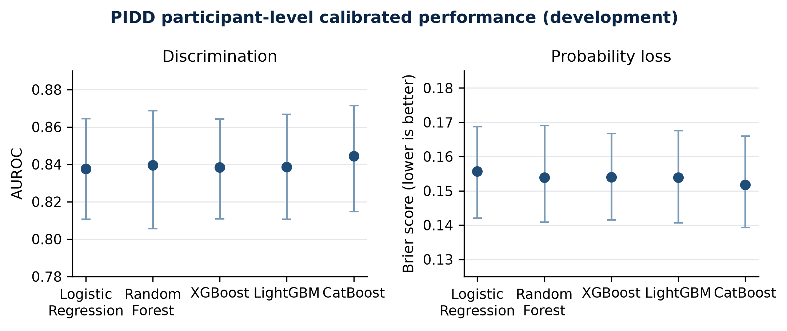
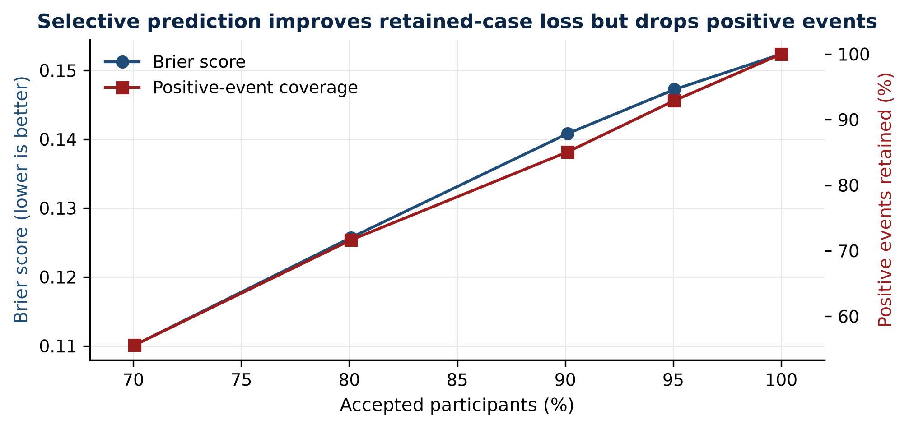
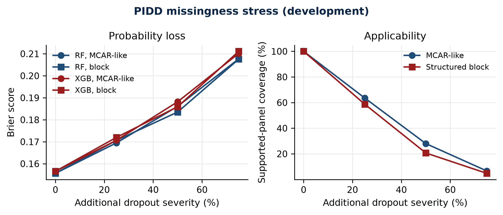
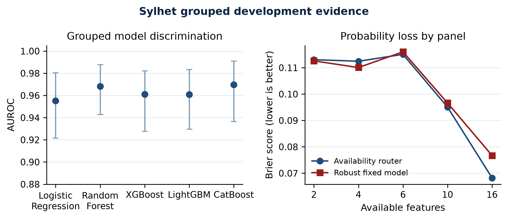
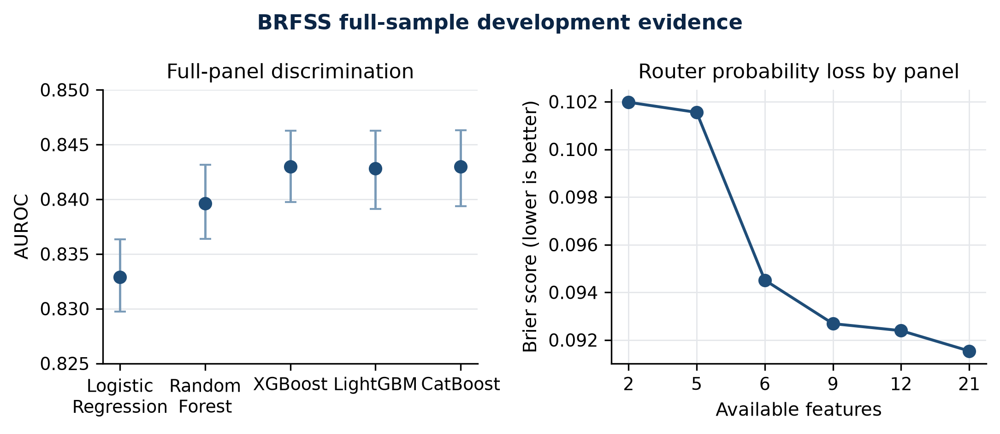

# Availability-Aware Diabetes Screening Under Incomplete Predictor Panels: A Multi-Environment Development Study

**Document state:** Development manuscript; not final evidence and not authorized for submission  
**Evidence cutoff:** 30 August 2026
**Target format:** Short applied machine-learning / health-informatics conference paper

## Abstract

**Background:** Diabetes-screening models are commonly evaluated with a fixed,
complete predictor set, although real users may provide only a clinically
meaningful subset. Models trained on public cohorts also represent different
endpoints and populations, making naïve cross-dataset fusion unsafe.

**Objective:** To evaluate how calibrated diabetes-status prediction changes
across prespecified feature-availability panels and whether an availability-aware
router preserves performance relative to strong fixed-model baselines while
abstaining outside evaluated routes.

**Methods:** PIDD, the Sylhet early-stage symptom cohort, and BRFSS 2015 are
treated as separate diabetes-status environments; Hospital130 is a distinct
30-day-readmission analysis. Logistic Regression, Random Forest,
XGBoost, LightGBM, and CatBoost are compared using leakage-controlled nested
cross-validation or a development holdout appropriate to each dataset. Model
selection occurs inside development data. Evaluation includes AUROC, average
precision, Brier score, log loss, calibration, threshold metrics, decision-curve
net benefit, paired uncertainty, reduced-panel degradation, selective prediction,
subgroups, missingness stress, and held-out SHAP explanations. The router chooses
only among models evaluated for a supported within-dataset panel and otherwise
abstains.

**Development results:** In the completed full-budget PIDD development study
(768 participants; 5 repeats x 5 outer folds), participant-aggregated calibrated
AUROC ranged from 0.838 to 0.844 and Brier score from 0.152 to 0.156 across the
five model families. CatBoost had the lowest participant-level Brier score
(0.152), but model
differences were small. For the full panel, the availability router achieved
participant-level AUROC 0.843 and Brier score 0.152; the robust fixed-model
baseline achieved AUROC 0.843 and Brier score 0.152. No reduced-panel comparison
survived metric-wise Holm correction in the matched contrast family. At 70%
coverage, probability-certainty selection reduced full-panel router Brier score
from 0.152 to 0.110 but retained only 55.6% of positive events, demonstrating a
clinically important coverage trade-off. With 75% simulated feature dropout,
supported-panel coverage fell to approximately 4.8%-6.6%, while Brier score rose
to approximately 0.208-0.211 for Random Forest and XGBoost. In the grouped Sylhet
development study (520 participants; 5 x 5 outer folds), CatBoost achieved
participant-level AUROC 0.970, average precision 0.984, Brier score 0.061, and
calibration slope 1.01. The full-panel router achieved AUROC 0.965 and Brier
0.068 versus 0.960 and 0.077 for the robust fixed baseline, without a corrected
significance claim. Across 32 Sylhet panel-specific-training contrasts, no
comparison survived Holm correction (minimum adjusted p=0.064). The full BRFSS
development study used 343,488 development and 85,872 development-test
respondents. XGBoost, CatBoost, and LightGBM had nearly identical calibrated
AUROC (0.843) and Brier score (0.0915); none of their pairwise differences was
Holm-significant. The development-selected LightGBM champion was retained even
though XGBoost had the numerically lowest test Brier score. Survey weighting
changed prevalence from 13.3% to 10.9% and increased XGBoost AUROC from 0.843 to
0.871, showing that sample-conditional and population-weighted estimands are not
interchangeable. In the separate Hospital130 development study, 99,343 retained
encounters from 69,990 patients yielded a 19,868-encounter patient-grouped test
partition. LightGBM was selected on development data and achieved calibrated
AUROC 0.679, average precision 0.229, Brier 0.0958, and calibration slope 1.02.

**Conclusion:** The development evidence supports a reliability and applicability
paper, not a universal-model or algorithm-superiority claim. Availability-aware
routing is technically feasible and traceable, but its incremental predictive
gain over a robust fixed model is small. Missingness and selective acceptance can
materially change both probability accuracy and which positive cases remain
covered; these effects must be reported alongside headline discrimination.

**Keywords:** diabetes screening; missing predictors; model routing; calibration;
selective prediction; abstention; explainable machine learning

## 1. Introduction

Public diabetes datasets are often used for model leaderboards in which a fixed
feature vector is assumed to be available for every person. That assumption is
fragile in practical screening: laboratory measurements may be absent,
questionnaire fields may be skipped, and different environments may collect
non-overlapping predictors. A system that always returns a probability can
therefore appear convenient while silently extrapolating beyond its evaluated
input patterns.

Missing-predictor handling is not a new problem. Pattern submodels,
deployment-time imputation, and flexible feature acquisition have established
that prediction can be adapted to incomplete inputs. Likewise, calibration,
SHAP explanations, fairness reporting, and multi-model comparison are already
well represented in diabetes modelling. The unresolved applied question is
narrower: how much calibrated performance is retained under clinically
interpretable feature panels, whether routing between evaluated models improves
on a robust fixed-model baseline, and when the system should abstain.

This study evaluates that question across three separately analysed
diabetes-status environments, with Hospital130 retained as a separate secondary
readmission analysis. Its contributions are: (1) endpoint-safe feature
and routing contracts; (2) matched evaluation of full and reduced panels on the
same held-out participants; (3) calibration, paired uncertainty, clinical
utility, selective prediction, subgroup coverage, and missingness stress beyond
headline accuracy; and (4) reloadable prediction bundles with explicit
provenance and fail-closed abstention. It does not claim future diabetes onset,
age of onset, causal risk factors, cross-cohort probability fusion, or clinical
deployment readiness.

## 2. Materials and methods

### 2.1 Prediction environments and endpoints

PIDD uses the configured binary diabetes-positive label in a high-risk Pima
population. Sylhet uses the early-stage diabetes-positive label from a
symptom-questionnaire cohort. BRFSS 2015 uses the configured self-reported
diagnosed-diabetes status. These are parallel environments, not exchangeable
samples of one universal population. Hospital130 predicts 30-day readmission and
is retained only as a separate secondary engineering analysis.

For mixed namespaced input, the software validates features against each dataset
contract, identifies eligible routers, and either invokes one explicitly
selected compatible expert or abstains. It never averages probabilities across
endpoints or cohorts.

### 2.2 Feature panels and preprocessing

Panels are prespecified in dataset configuration. PIDD includes the full
eight-feature panel and reduced panels representing core metabolic,
glucose-plus-age, non-laboratory, routine-clinic, and no-insulin-or-skinfold
availability. Dataset-specific preprocessing is fitted inside each training
partition. PIDD physiologically implausible zeros are treated according to the
configured missingness contract; indicator-on and indicator-off variants are
evaluated in a separate retraining ablation.

The pipeline rejects unknown features, invalid values, unsupported panels, and
ambiguous multi-environment requests. The returned percentage is the calibrated
estimated probability of the configured recorded label in the selected
environment. It is not a diagnosis or a forecast of age at diabetes onset.

### 2.3 Models and validation

Candidate models are Logistic Regression, Random Forest, XGBoost, LightGBM, and
CatBoost. PIDD uses repeated stratified nested cross-validation with five repeats,
five outer folds, five inner folds, and 30 tuning trials per model-fold. Sylhet
uses grouped splitting so identical feature profiles do not cross partitions.
Large holdout datasets use outcome-blind split manifests and dataset-appropriate
participant or patient grouping. Hyperparameter optimization targets average
precision.

Calibration candidates are identity, sigmoid, and isotonic calibration, selected
without access to outer evaluation outcomes. Isotonic calibration is disabled
below the configured minimum calibration sample size. Threshold reports include
0.5, development Youden, and sensitivity-constrained policies; probability
metrics remain primary.

### 2.4 Availability routing

For each supported panel and outer training partition, candidate model families
are ranked using inner-development Brier score, with log loss and average
precision as tie-breakers. The selected bundle stores the dataset, endpoint,
panel, preprocessing contract, calibration method, threshold policy, training
split identity, software provenance, and supported applicability range.

The primary routing comparison is against a prespecified robust fixed model
evaluated on the identical participants and panel. A full-panel champion-family
baseline is also evaluated after masking unavailable inputs. Model-family
switching is considered superior only if the paired Brier improvement is at
least 0.005, its 95% interval excludes zero, and its Holm-adjusted two-sided
p-value is below 0.05. Otherwise switching is reported as negative or
inconclusive.

### 2.5 Outcomes and statistical analysis

Brier score is the primary probability metric. AUROC and average precision are
primary discrimination metrics. Supporting estimates include log loss,
calibration intercept and slope, observed-to-expected ratio, expected
calibration error, sensitivity, specificity, PPV, NPV, F1, MCC, likelihood
ratios, and decision-curve net benefit.

Repeated held-out predictions are averaged per unique participant before primary
inference. Sylhet uncertainty resamples complete identical-profile clusters.
Panel and model comparisons are paired on the same participants. Percentile
bootstrap confidence intervals and metric-wise Holm correction are used for
comparison families. Reduced-panel degradation is oriented so positive values
always mean worse performance.

Selective prediction ranks cases using the outcome-blind score
`2 x |probability - 0.5|` at 100%, 95%, 90%, 80%, and 70% target coverage. We
report actual coverage, retained positive-event coverage, accepted prevalence,
probability performance, and supported subgroup coverage. This score is an
evaluated baseline, not an assumed optimal deferral policy.

### 2.6 Explainability, stress tests, and reproducibility

SHAP values are computed only for held-out observations and are grouped back to
original clinical features before primary reporting. Encoded-column explanations
remain diagnostic. Missingness stress applies shared MCAR-like and structured
block masks to Random Forest and XGBoost at 0%, 25%, 50%, and 75% severity over
five replicates. Deliberately invalid global-preprocessing and naïve-split runs
are isolated as leakage demonstrations and prohibited from efficacy tables.

Every run records raw-data, configuration, split-manifest, and source-tree
hashes. Saved models, calibrators, predictions, tuning records, thresholds,
uncertainty tables, routing bundles, and explanations are linked by experiment
identifier. Final profiles fail closed until a signed protocol and authorization
record exist.

## 3. Development results

### 3.1 PIDD full-panel model performance

The full-budget PIDD development run contained 25 outer evaluations for each of
five models and complete participant aggregation for all 768 individuals. Table
1 reports calibrated probabilities with the fixed 0.5 descriptive threshold.
Differences were modest: the participant-level absolute Brier range was 0.0039
and the AUROC range was 0.0067.

**Table 1. PIDD calibrated participant-level development performance after averaging each participant across five repeats**

| Model | AUROC | Average precision | Brier | Log loss | Calibration slope | ECE |
|---|---:|---:|---:|---:|---:|---:|
| CatBoost | 0.844 | 0.709 | 0.152 | 0.462 | 1.050 | 0.038 |
| Random Forest | 0.840 | 0.710 | 0.154 | 0.468 | 1.046 | 0.032 |
| LightGBM | 0.839 | 0.713 | 0.154 | 0.468 | 1.033 | 0.038 |
| Logistic Regression | 0.838 | 0.712 | 0.156 | 0.475 | 1.036 | 0.043 |
| XGBoost | 0.838 | 0.706 | 0.154 | 0.469 | 1.041 | 0.026 |

These results do not support a claim that a complex model clearly dominates the
interpretable baseline.

**Figure 1.** PIDD calibrated development performance across five model
families. Error bars show 95% participant-bootstrap confidence intervals for
participant-level estimates.

### 3.2 Feature availability and routing

At participant level, the full-panel availability router achieved AUROC 0.843,
average precision 0.706, Brier 0.152, and log loss 0.464. The robust fixed-model
baseline achieved AUROC 0.843, average precision 0.709, Brier 0.152, and log loss
0.463. The practically sized core-metabolic router achieved AUROC 0.839 and
Brier 0.154; the two-feature glucose-plus-age router achieved AUROC 0.809 and
Brier 0.166; the non-laboratory router achieved AUROC 0.756 and Brier 0.186.

Matched full-versus-reduced contrasts were estimated within model family on the
same participants. None of the 80 metric-panel-model comparisons had a
Holm-adjusted p-value below 0.05. The smallest adjusted value was approximately
0.080 for CatBoost AUROC degradation on the glucose-plus-age panel. This is
evidence of limited precision and multiplicity, not evidence of equivalence.

Separately training Random Forest and XGBoost for each reduced panel rather than
masking unavailable inputs in a full-panel model produced several nominal
improvements, including a 0.009 AUROC gain for XGBoost on glucose-plus-age and a
0.034 average-precision gain for Random Forest on the non-laboratory panel.
However, none of the 40 paired comparisons survived Holm correction; the minimum
adjusted p-value was 0.120. Panel-specific fitting is therefore not supported as
a superiority claim.

### 3.3 Selective prediction and subgroup coverage

For the full-panel router, lowering coverage from 100% to 70% improved Brier
score from 0.152 to 0.110 and AUROC from 0.843 to 0.882. However, only 149 of 268
positive events were retained (55.6%), compared with 389 of 500 negative cases
(77.8%). The apparent performance improvement therefore came with asymmetric
case retention and cannot be presented without event coverage.

Age-group analysis showed heterogeneous acceptance at 70% overall coverage:
81.3% of participants younger than 30 were accepted, compared with 60.3% aged
30-44, 55.4% aged 45-59, and 50.0% aged 60 or older. The oldest group contained
only 32 participants and was suppressed for performance estimation. These
findings make probability certainty unsuitable as an unqualified clinical
abstention rule.

**Figure 2.** Full-panel PIDD availability-router probability loss and
positive-event retention across selective-prediction coverage levels.

### 3.4 Missingness stress and explanations

Under 75% MCAR-like feature dropout, supported-panel coverage was 6.6%, Random
Forest Brier score increased from 0.156 to 0.208, and XGBoost Brier score
increased from 0.157 to 0.210. Under 75% structured-block dropout, supported-panel
coverage fell to 4.8%, with Brier scores of 0.208 and 0.211, respectively. The
results support fail-closed applicability checks rather than unconditional
prediction under arbitrary missingness.

**Figure 3.** PIDD probability loss and supported-panel coverage under
simulated feature dropout. Points summarize five-replicate stress evidence;
mechanisms are sensitivity analyses rather than real-world MNAR validation.

Held-out SHAP artifacts were produced for every completed model-fold and grouped
to original features. The reporting ablation retains original-feature grouping
as primary because it avoids splitting clinical concepts into preprocessing and
missing-indicator fragments.

In the full 25-fold retraining ablation, enabling missingness indicators did not
produce a Holm-corrected improvement for Logistic Regression or Random Forest
on AUROC, average precision, Brier score, or log loss; all adjusted p-values were
at least 0.200. Indicator handling therefore remains an implementation choice,
not a supported performance contribution.

### 3.5 Grouped Sylhet development results

The full-budget Sylhet study contained 25 outer evaluations for each model. Each
participant's five held-out probabilities was averaged before primary metrics,
and uncertainty resampled complete identical-profile clusters. CatBoost had the
lowest participant-level Brier score (0.061) and highest AUROC (0.970), followed
by Random Forest (Brier 0.067; AUROC 0.968). Participant-level calibration slopes
were 1.01 and 1.13, respectively. High internal discrimination still does not
establish transportability beyond this small symptom-enriched cohort.

**Table 2. Sylhet calibrated participant-level development performance with identical-profile cluster inference**

| Model | AUROC | Average precision | Brier | Log loss | Calibration slope | ECE |
|---|---:|---:|---:|---:|---:|---:|
| CatBoost | 0.970 | 0.984 | 0.061 | 0.213 | 1.010 | 0.038 |
| Random Forest | 0.968 | 0.981 | 0.067 | 0.226 | 1.126 | 0.034 |
| XGBoost | 0.961 | 0.977 | 0.075 | 0.245 | 1.057 | 0.021 |
| LightGBM | 0.961 | 0.978 | 0.072 | 0.245 | 0.931 | 0.029 |
| Logistic Regression | 0.955 | 0.974 | 0.081 | 0.262 | 0.989 | 0.024 |

**Figure 4.** Sylhet participant-level model discrimination and panel-specific
probability loss under grouped development validation. Intervals use identical-
profile cluster resampling.

At participant level, the full-panel router achieved AUROC 0.965 and Brier 0.068,
whereas the robust fixed model achieved AUROC 0.960 and Brier 0.077. The paired
router-versus-fixed interval crossed no improvement after cluster resampling, and
no routing ablation survived Holm correction. Reduced panels showed descriptive
loss: the 10-feature core questionnaire router had AUROC 0.945 and Brier 0.095,
while the two-feature polyuria-polydipsia router had AUROC 0.905 and Brier 0.113.
None of 64 matched full-versus-reduced contrasts survived Holm correction; the
minimum adjusted p-value was 0.064.

Separately tuned panel-specific Random Forest and XGBoost pipelines were also
compared with masked full-panel inference across all four reduced panels and all
25 grouped outer splits. The analysis produced 41,600 held-out prediction rows
and 32 participant-paired, profile-cluster-resampled metric contrasts. No
contrast survived metric-wise Holm correction (minimum adjusted p=0.064). The
largest descriptive Brier improvement was 0.006 for XGBoost on the 10-feature
core questionnaire panel, with its interval crossing zero. Panel-specific
training therefore remains an inconclusive engineering option rather than a
supported superiority result.

The full missing-indicator retraining comparison likewise found no
Holm-corrected benefit. Random Forest predictions were numerically equivalent
with indicators on and off, while Logistic Regression differences were small
and all adjusted p-values were 1.000. This is expected because the Sylhet
questionnaire does not contain applicable numeric missingness for the indicator
transformer.

At 70% selective coverage, the full-panel router Brier score improved from 0.062
to 0.025 while retaining 76.9% of positive events. Subgroup support remained a
major caveat: the accepted female cell contained no negative events and was
suppressed, as were the youngest and oldest age groups. Under 75% simulated
dropout, supported-panel coverage fell to 4.0%-6.2% and Brier score rose to
0.278-0.289 across Random Forest and XGBoost.

### 3.6 Full BRFSS development results

The full BRFSS development study
`brfss_development_holdout_56407ef53bba` used all 429,360 retained respondents:
343,488 for five-fold development tuning and cross-fitted selection and 85,872
in the pre-existing seed-42 development test role (11,451 positives; prevalence
13.3%). This partition had already been inspected and is permanently ineligible
as a concealed final test. All model, calibration, threshold, and champion
choices were locked from development data before test prediction.

**Table 3. BRFSS calibrated full-development performance on the development test partition**

| Model | AUROC | Average precision | Brier | Log loss | Calibration slope | ECE |
|---|---:|---:|---:|---:|---:|---:|
| XGBoost | 0.843 | 0.444 | 0.0915 | 0.2958 | 1.008 | 0.0023 |
| CatBoost | 0.843 | 0.442 | 0.0915 | 0.2958 | 1.008 | 0.0018 |
| LightGBM | 0.843 | 0.443 | 0.0915 | 0.2960 | 1.016 | 0.0020 |
| Random Forest | 0.840 | 0.437 | 0.0921 | 0.2981 | 0.997 | 0.0022 |
| Logistic Regression | 0.833 | 0.404 | 0.0940 | 0.3031 | 0.976 | 0.0033 |

Development OOF Brier score selected LightGBM as champion (0.091391 versus
0.091395 for XGBoost and CatBoost). On the development test, XGBoost had the
numerically lowest Brier score (0.091497; 95% interval 0.090817-0.092218), but
the top-three pairwise Brier, log-loss, AUROC, and average-precision differences
were not Holm-significant. The champion was not reselected using test outcomes.

The descriptive 0.5 threshold had high specificity (0.980-0.987) but low
sensitivity (0.113-0.179). Development sensitivity-constrained thresholds near
0.14 achieved 0.802-0.814 sensitivity with 0.704-0.726 specificity. This large
operating-point change reinforces that 0.5 is not an implied clinical cutoff.

The availability router selected LightGBM for the full 21-feature panel and
XGBoost for each reduced panel using development cross-fitted Brier score. Test
Brier score increased from 0.0915 for the full panel to 0.0924 for 12 routine
survey features, 0.0927 for nine cardiometabolic/health features, 0.0945 for six
health-status features, 0.1016 for five demographic/health features, and 0.1020
for general health plus age. These are development degradation estimates, not
optimized deployment rules. All 80 same-participant, same-family reduced-panel
contrasts had degradation intervals excluding zero, but none survived the
metric-wise Holm family (minimum adjusted p=0.080); this resolution limit must
not be rewritten as equivalence or as a corrected significance claim.

Certainty-based selective prediction was particularly unfavorable to positive
cases. At 70% coverage, full-panel Brier score fell from 0.0915 to 0.0430, but
only 2,859 of 11,451 positive events remained (25.0% event coverage), accepted
prevalence fell to 4.8%, AUROC fell to 0.784, and average precision fell to
0.128. The improved retained-case loss primarily reflects rejection of higher-
risk cases and does not support an unqualified abstention benefit.

All 30 prespecified age- and sex-stratified coverage cells met the minimum size
and event counts. At the 70% target, observed acceptance ranged from 69.7% to
70.3% across the four age groups and two sex groups. Within-group positive-event
retention nevertheless fell sharply, with accepted prevalences of 4.6%-4.8% and
average precision of 0.125-0.133. The subgroup results therefore reinforce the
case-mix warning; they do not establish population fairness.

The model-family ablation found that every tree family improved on Logistic
Regression for AUROC, average precision, Brier score, and log loss after Holm
correction (adjusted p=0.016 for the reported 500-replicate family). This is a
development contrast, not a final superiority result. Selector-metric variants
did not produce corrected differences, and the router-versus-robust-single-model
family did not support a routing advantage. Calibration materially improved
CatBoost probability loss because its raw scores required correction; LightGBM
selected identity calibration and therefore showed no calibration change.

Held-out SHAP analysis explained 1,000 development-test respondents per model
using a 100-row development background. General health, high blood pressure,
age, BMI, and high cholesterol occupied the top five original-feature positions
for four model families; CatBoost used the same set with a different order.
Additive reconstruction error was at most 5.6e-6. These explanations describe
model behavior and must not be interpreted as causal effects.

**Figure 5.** BRFSS model discrimination and router probability loss under the
full-sample development protocol. AUROC intervals use 500 participant-bootstrap
replicates.

Survey-weighted sensitivity analysis represented 53 reporting areas and 1,292
strata; the Kish effective sample size was 21,165.5. Weighted prevalence was
10.9% rather than 13.3%. Weighted XGBoost AUROC was 0.871 (95% PSU-bootstrap
interval 0.864-0.877) and Brier score was 0.0752 (0.0730-0.0778). These estimates
are secondary sensitivity analyses because the random respondent holdout was not
designed as an official survey-analysis partition.

Historical 10,000-row BRFSS smoke studies remain engineering evidence. A future
final estimate still requires a different prespecified concealed manifest and
one authorized execution after protocol freeze.

### 3.7 Separate Hospital130 readmission development analysis

Hospital130 remains outside the diabetes-screening result family because its
endpoint is readmission within 30 days. After excluding death and hospice
dispositions, 99,343 encounters from 69,990 patients remained (11,314 positive;
11.39% prevalence). Patient-grouped splitting assigned 79,475 encounters to five
development folds and 19,868 encounters from 14,003 patients to the development
test role, with no patient crossing the partitions or development folds.

**Table 4. Hospital130 calibrated full-development performance on the patient-grouped development test partition**

| Model | AUROC | Average precision | Brier | Log loss | Calibration slope | ECE |
|---|---:|---:|---:|---:|---:|---:|
| LightGBM | 0.679 | 0.229 | 0.0958 | 0.3327 | 1.019 | 0.0066 |
| XGBoost | 0.678 | 0.227 | 0.0959 | 0.3331 | 1.029 | 0.0053 |
| CatBoost | 0.678 | 0.229 | 0.0959 | 0.3330 | 1.028 | 0.0070 |
| Random Forest | 0.673 | 0.228 | 0.0960 | 0.3339 | 1.020 | 0.0047 |
| Logistic Regression | 0.661 | 0.201 | 0.0971 | 0.3377 | 0.979 | 0.0070 |

Development OOF Brier score selected sigmoid-calibrated LightGBM. Its 95%
patient-cluster intervals were 0.667-0.691 for AUROC, 0.213-0.245 for average
precision, and 0.0918-0.0992 for Brier score. None of the four tree families
differed from another after metric-wise Holm correction. Each tree family did
improve over Logistic Regression across the four artifact-ablation metrics after
correction; these are development comparisons, not final superiority claims.

The router retained LightGBM for the full 46-feature and nine-feature
admission-clinical panels, and selected Random Forest for the nine-feature
encounter-utilization, five-feature prior-utilization, and two-feature
minimal-history panels. Full-panel Brier was 0.0958; reduced-panel Brier ranged
from 0.0982 to 0.0994. At 80% full-panel selective coverage, accepted prevalence
fell to 7.62% while rejected prevalence rose to 26.45%, demonstrating substantial
case-mix shift. Prespecified age, sex, and race estimates were generated, with
small cells suppressed. Held-out SHAP for the selected LightGBM model ranked
prior inpatient encounters and discharge disposition highest; maximum additive
reconstruction error was 1.2e-14. These findings describe internal development
behavior and do not establish clinical utility or external validity.

## 4. Discussion

The development study changes the likely paper narrative. The strongest result
is not algorithm superiority: five model families produced very similar PIDD
probability performance, and the availability router was nearly indistinguishable
from a robust fixed model on the full panel. The contribution is instead an
evaluation framework that quantifies what is lost under specific availability
patterns and refuses unsupported prediction.

The reduced-panel results are clinically interpretable. Core metabolic features
retained most full-panel performance, whereas a non-laboratory panel and an
extreme two-feature panel showed larger losses. Yet multiplicity-adjusted matched
comparisons were imprecise in this small dataset. The correct conclusion is that
panel degradation can be measured and may be operationally modest for selected
panels, not that the panels are statistically equivalent.

Selective prediction illustrates why coverage must accompany accuracy. A simple
probability-certainty rule produced better retained-case metrics but discarded a
large fraction of positive cases and accepted age groups at different rates.
Likewise, missingness stress showed rapid collapse in supported-panel coverage at
high severity. A safe system needs an applicability layer and explicit
abstention reason, not only a calibrated score.

The full BRFSS study adds precision but does not change the negative algorithm-
superiority narrative: the three boosted-tree models were practically
indistinguishable at reported precision, and the development-selected champion
was not the numerical test leader on every metric. Survey weighting materially
changed prevalence and performance, so population-weighted sensitivity results
must remain separate from sample-conditional estimates.

The separate Hospital130 analysis reached a similar methodological conclusion:
tree-family performance was close, reduced panels degraded probability quality,
and certainty-based deferral preferentially rejected higher-risk encounters. It
supports the pipeline's endpoint and applicability safeguards, not a diabetes-
status claim and not a clinically validated readmission tool.

The study has important limitations. All primary datasets are public and mostly
cross-sectional; they do not measure future incidence or age of onset. PIDD and
Sylhet are small, and public benchmark reuse limits transportability. BRFSS uses
self-reported status and requires careful survey-design interpretation. The
current selective score is a baseline rather than an optimized clinical deferral
policy. Hospital130 is retrospective, lacks external or temporal validation, and
its development-test outcomes have been inspected. No matched cohort contains
all PIDD, Sylhet, and BRFSS attributes for the
same individuals, so mixed-input routing is not efficacy-validated fusion.
External or temporal validation remains necessary for clinical-generalization
claims.

## 5. Conclusion

An availability-aware, calibrated diabetes-screening pipeline can provide
traceable within-environment probabilities from prespecified feature panels and
abstain when no evaluated route is supported. In PIDD development evidence, the
router did not materially outperform a robust fixed model, while reduced panels,
selective acceptance, and simulated missingness changed both probability quality
and population coverage. The conference contribution should therefore be framed
around reliability under incomplete inputs, endpoint safety, survey-estimand
transparency, and negative findings. The full BRFSS study remains development
evidence because its seed-42 test role was already inspected. Locked evaluation
on a genuinely new concealed manifest and independent review are required before
submission.

## Declarations

**Ethics:** The study uses de-identified public datasets; dataset-specific terms
and institutional requirements must be confirmed by the authors before
submission.  
**Funding:** To be completed by the authors.  
**Conflicts of interest:** To be completed by the authors.  
**Data and code availability:** Repository URL, release tag, and archived DOI to
be inserted after protocol freeze and artifact review.  
**Author contributions:** To be completed using the venue's required taxonomy.

## References requiring final bibliographic formatting

1. TRIPOD+AI statement. BMJ. 2024;385:e078378.
2. PROBAST+AI. BMJ. 2025;388:e082505.
3. Evaluation of clinical prediction models, part 2. BMJ. 2024;384:e074820.
4. Vickers AJ, Elkin EB. Decision curve analysis. Med Decis Making. 2006.
5. UCI Machine Learning Repository. Early Stage Diabetes Risk Prediction dataset.
6. Handling missing predictor values when validating and applying a prediction model. BMC Med Res Methodol. 2020.
7. Missing data and prediction: the pattern submodel. Biostat Epidemiol. 2021.
8. Real-time imputation of missing predictor values in clinical practice. J Clin Epidemiol. 2022.
9. Building type 2 diabetes prediction models using the 2014 BRFSS. Prev Chronic Dis. 2019.
10. Original PIDD/ADAP study and dataset provenance record.

The reference list is a development placeholder. Titles, authors, volume,
pages, DOI, and venue style must be verified against full text before submission.
