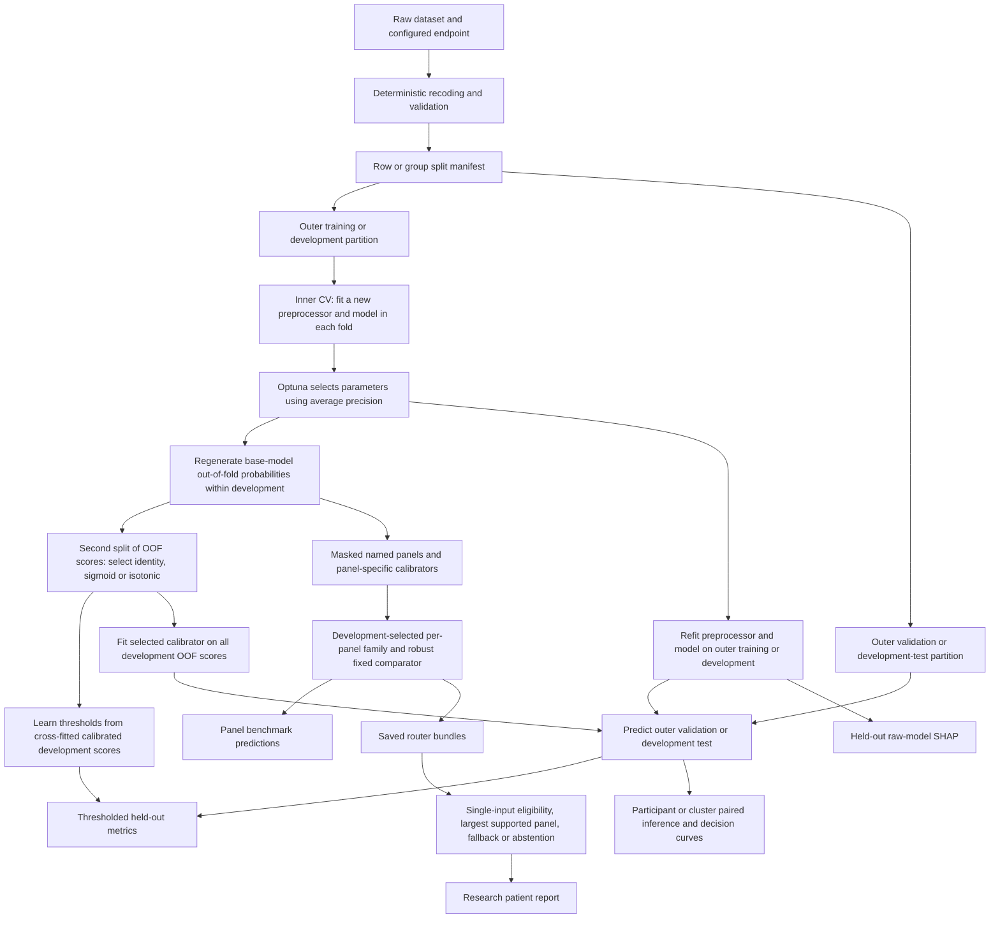

# Final repository-wide technical and research audit

**Audit date:** 5 September 2026  
**Repository:** `/Users/pranavprabhu/Codex/Minor Proj/T2DM`  
**Audited HEAD:** `c964664ddaa1e4a1fbc6dd72fde9dfb66fc88cfc`  
**Remote configured locally:** `git@github.com:OppositeExpert/T2DM.git`  
**Scope:** source, configuration, CLI, tests, research protocol, reporting scripts, tracked evidence, and relevant ignored raw data/model/prediction artifacts. This is an audit of the local checkout; no remote synchronization was performed.  
**Pre-existing working-tree change:** `docs/DEFINITIVE_PROJECT_CONTEXT.md`. It was read as a working document and preserved.  
**Evidence:** [machine-readable audit evidence](audit_evidence.json), [probe instructions](probes/README.md). No full-development or final experiment was launched.

## Executive summary

**Verdict: RESEARCH-READY AFTER BLOCKING FIXES.** This describes a recoverable research implementation, not present submission approval. The current manuscript and affected outputs should not be submitted unchanged.

The core design is substantially sound: independent dataset-specific models, fold-local preprocessing, development-only selection, profile/patient grouping, explicit endpoint separation, matched comparisons, and conservative default handling of ambiguous mixed-cohort requests. The source does considerably more than a classifier leaderboard. Its honest negative routing results and development-only labels are strengths worth preserving.

However, passing tests and valid checksums concealed a serious existing-results bug. **BRFSS and Hospital130 subgroup labels are assigned to the wrong rows after filtering.** The saved subgroup files reproduce this error. Statements about subgroup coverage, subgroup performance, and fairness-related interpretation derived from those files are invalid until regenerated. This is the one BLOCKER finding; its impact is specific to those analyses, not proof that every model metric is wrong.

Seven HIGH findings concern the mismatch between panel benchmarking and actual routing eligibility, weak split and bundle identity checks, the readiness gate, the incomplete final-analysis workflow, the proposed meaning of a fresh final holdout, and historical reproduction. Additional findings cover input validation, calibration-selection qualifications, legacy inference, SHAP aggregation, configuration drift, and reporting.

The direct answers are:

| Question | Assessment |
|---|---|
| Is the implementation fundamentally sound? | Yes at the level of the development modeling architecture; several important evaluation and contract details require repair. |
| Any blockers/high issues? | 1 BLOCKER and 7 HIGH findings below. The repository's separate publication gate currently reports 15 failed prerequisites and 1 warning. Those are not the same count as this audit's findings. |
| Evidence of leakage? | No observed Sylhet/Hospital130 group overlap in the authoritative saved partitions, and no outer-test labels found entering ordinary model fitting, calibration, threshold selection, or model selection. Corrupt manifests can nevertheless pass validation. Final concealment is not an independent data-custody boundary. |
| Invalid statistics? | Subgroup estimates are based on wrong membership. Legacy fold-based inferential tables and missingness-stress CIs ignore dependence. The newer participant/cluster paired analyses are substantially stronger, with qualifications about conditional uncertainty. |
| Incorrect endpoint handling? | Actual current Hospital130 outcomes are correctly treated as `<30` versus `>30`/`NO`, separately from screening. Unknown raw outcomes can silently become negative. Patient-report provenance assertions are insufficient. |
| Unsafe cross-dataset behavior? | No automatic probability fusion found. Ambiguous mixed requests abstain by default and Hospital130 is rejected from screening mixtures. The report API can accept inconsistent bundle/reference identities in controlled counterexamples. |
| Reproduction failures? | Two authoritative metadata files point to a nonexistent old checkout. Large artifacts have no populated external archive location. Two historical source hashes were not recoverable from the available Git source revisions. |
| Could conclusions change? | Yes: subgroup conclusions must change or be reconfirmed. Actual fallback/abstention-policy performance is not established by the panel tables. Resolving the BRFSS feature definition could require a BRFSS rerun. No evidence was found requiring an indiscriminate rerun of every dataset. |

Execution independently reproduced all **80 AUROC/AP/Brier/log-loss estimates** in the 20-row, five-model/four-dataset development performance snapshot within `1e-12`. The 107-test suite passed. All 1,962 registered study-artifact hashes and all 48 conference-package hashes verified. These results support numerical and byte consistency; they do not validate the methods that produced those bytes.

## Reconstructed project and execution architecture

### Dataset and evidence contracts

| Dataset | Loaded records / positives | Predictors | Identity and split | Current authoritative study |
|---|---:|---:|---|---|
| PIDD | 768 / 268 | 8 numeric | Row identity; 5 repeats × 5 outer folds | `pidd_development_072cd2104089` |
| Sylhet | 520 / 320 | 16 numeric-coded | 251 identical-feature-profile groups; grouped 5 × 5 outer CV | `sylhet_development_b52477910fe6` |
| BRFSS 2015 | 429,360 / 57,256 | 21 numeric-coded | 343,488 development + 85,872 development-test respondents | `brfss_development_holdout_56407ef53bba` |
| Hospital130 | 99,343 / 11,314 | 9 numeric + 37 categorical | 69,990 patients; 79,475 development + 19,868 development-test encounters, separated by patient | `hospital130_development_holdout_c3aa5fb84a7a` |

PIDD zero sentinels in five physiological fields become missing before learned preprocessing. Sylhet has 269 repeated feature rows; grouping uses the complete predictor profile, not an inferred patient identifier. BRFSS retains only `DIABETE3` codes 1 and 3 and retains predictor missingness. Hospital130 excludes configured death/hospice discharge dispositions and removes patient/encounter IDs from predictors. Its endpoint is 30-day readmission among diabetes-related encounters, not diabetes occurrence. The original dataset describes an early-readmission outcome after discharge. [UCI Hospital130 description](https://archive.ics.uci.edu/dataset/296/diabetes%2B130-us%2Bhospitals%2Bfor%2Byears%2B1999-2008).

All four authoritative declarations are **full development**. No authoritative final-locked study exists. The final profile is unlocked; `protocol_frozen`, split-creation authorization, and final-execution authorization are false. The development profile has 30 tuning trials and 500 bootstrap resamples. PIDD/Sylhet use five repetitions; BRFSS/Hospital130 use development CV followed by an already-accessed development-test partition. Smoke, pilot, development, and final budgets are intentionally different.

### Actual prediction flow

The extra calibration split operates on an already-created OOF score table, not a complete fresh nesting of the entire tuning/model pipeline. The distinction matters for interpreting internal selection scores; it does not by itself put outer-test outcomes into fitting.

Named-panel evaluation generally masks unavailable columns of models trained on the full predictor set, then calibrates by panel using development predictions. Separate panel-specific-training ablations test a different strategy. The router selects a model family by development Brier score, then log loss and AP; runtime panel choice is primarily the largest supported panel. It is not a per-person oracle or a search for the highest-scoring panel on test outcomes. The robust fixed model is selected using average development loss across panels, making it a reasonable comparator for the intended design.

### Repository coverage and boundaries of the audit

The audit traced loaders, validators and audit writers; ordinary/concealed splits; preprocessors and all five model adapters; tuning and OOF generation; calibration and thresholds; both runners; bootstrap/comparison/repeated-CV/DCA routines; panel evaluators and inference; selective/subgroup/survey/missingness analyses; artifact and retraining ablations; SHAP and feature restoration; the ontology; patient/mixed reports; readiness checks; acquisition/release/registry/manuscript scripts; dependency configuration; Docker and CI; schemas; tests; research methods and current manuscript claims.

Historical progress reports and the system-model report were examined as history. They are explicitly superseded and should not be deleted merely because their metrics differ. Source/config/document inventory hashes and the 29 test-module inventory are in the evidence JSON. All 104 tracked Python files passed syntax compilation. Generated evidence was checked through manifests, representative metadata/bundles, row-level predictions, and targeted recalculation; no claim is made that every pixel of every historical DOCX/PDF was reviewed. No clean-machine download, Docker build, remote CI run, external validation, or full model retraining was performed.

## Findings table

“Targeted” includes regenerating derived tables/reports from unchanged saved predictions, or evaluating saved models, as specified in the detailed finding. A proposed protocol change is not authorized by this report.

| ID | Severity | Confidence | Area | Short finding | Results affected? | Rerun needed? |
|---|---|---|---|---|---|---|
| AUDIT-001 | BLOCKER | CONFIRMED | Subgroups | Filtered-row index alignment corrupts BRFSS/Hospital130 membership | Yes | Targeted |
| AUDIT-002 | HIGH | CONFIRMED | Availability/routing | Panel benchmarks do not evaluate the actual eligibility/fallback policy | Yes, interpretation; policy performance unknown | Targeted |
| AUDIT-003 | HIGH | CONFIRMED | Splits/provenance | Invalid row positions pass validation; ordinary split paths are mutable | No demonstrated corruption of current splits | None for current verified splits |
| AUDIT-004 | HIGH | CONFIRMED | Bundles/provenance | Inconsistent study/endpoint/reference identities are accepted | Unknown; demonstrated with controlled inputs | None, then targeted integrity verification |
| AUDIT-005 | HIGH | CONFIRMED | Readiness | Empty, contradictory, unauthorized artifacts can be marked ready | No current promotion | None |
| AUDIT-006 | HIGH | CONFIRMED | Final workflow | Gate requires outputs whose supported commands reject final studies | No final study exists | None now; final workflow validation before use |
| AUDIT-007 | HIGH | HIGH CONFIDENCE | Final evidence | New seed/concealment cannot restore previously unseen data; access receipt is late | No current final claims authorized | None for honest development claims; new final evidence if claimed |
| AUDIT-008 | HIGH | CONFIRMED | Reproducibility | Broken historical paths, incomplete source recovery and no artifact archive | Yes, reproduction | None if artifacts/source restored; otherwise affected dataset |
| AUDIT-009 | MEDIUM | PLAUSIBLE / NEEDS VERIFICATION | BRFSS semantics | `CholCheck` encodes ever checked; five-year source meaning is unresolved | Unknown | None if documented as ever; affected dataset if recoded |
| AUDIT-010 | MEDIUM | CONFIRMED | Data validation | Unknown Hospital130 labels become negative; validation lacks numeric-domain checks | No current invalid target found | None |
| AUDIT-011 | MEDIUM | CONFIRMED | Input safety | Unseen categorical values can produce patient probabilities | Patient outputs, yes | None; targeted inference checks |
| AUDIT-012 | MEDIUM | HIGH CONFIDENCE | Calibration | Internal OOF selection is not fully nested cross-fitting of the complete learner | Internal selection interpretation; outer effect unknown | None for wording; affected dataset if method changed |
| AUDIT-013 | LOW | CONFIRMED | Calibration robustness | Isotonic minimum and grouped fold feasibility are checked too coarsely | No current study effect demonstrated | None |
| AUDIT-014 | MEDIUM | CONFIRMED | Inference | Legacy fold inference and stress CIs ignore dependence; Sylhet legacy intervals omit groups | Legacy tables, yes | Targeted |
| AUDIT-015 | MEDIUM | CONFIRMED | Uncertainty | Bootstrap scope and failed-replicate accounting are incomplete | Uncertainty interpretation; failures unknown | None for qualification; targeted for diagnostics |
| AUDIT-016 | MEDIUM | CONFIRMED | SHAP | Local top contributors mix different repeat/fold explanations | Yes | Targeted |
| AUDIT-017 | MEDIUM | CONFIRMED | Manuscript | Sylhet routing fold means are called participant-level estimates | Yes, text | None; regenerate text/tables |
| AUDIT-018 | MEDIUM | CONFIRMED | Configuration/protocol | Executable settings and draft methodology disagree; some settings are inert | Documentation and intended protocol; numerical impact conditional | Targeted or affected dataset only if behavior changed |
| AUDIT-019 | MEDIUM | CONFIRMED | Patient reporting | Display loses evidence details; the 25-model ensemble has a different evaluation target | Yes, interpretation | None for disclosure; targeted evaluation if performance claimed |
| AUDIT-020 | MEDIUM | HIGH CONFIDENCE | Hospital130 timing | Admission-named panel includes discharge/encounter-end information | Claim scope, yes | None for discharge-time framing; affected dataset for admission-time redesign |
| AUDIT-021 | LOW | CONFIRMED | ICD preprocessing | Decimal boundary codes fall into the wrong diagnostic category | No: zero affected current values | None |
| AUDIT-022 | INFO | CONFIRMED | Ontology/reviewer limits | Semantic annotations are useful but do not validate conversions or populations | No implementation defect established | None |

## Detailed findings

### AUDIT-001 — Subgroup labels are assigned to the wrong participants

**Severity:** BLOCKER. **Confidence:** CONFIRMED. **Area:** subgroup evaluation, data identity, manuscript claims.

**Files/functions:** `src/diabetes_pipeline/evaluation/subgroup_analysis.py:62` (`subgroup_membership`), especially lines 66, 72, 86–98; `src/diabetes_pipeline/data/loaders.py:87` and `:244`; `tests/test_subgroup_analysis.py:17`; `conference_package/Conference_Manuscript_Development_Draft.md:408`.

**Problem:** The membership base frame uses a new contiguous index from `row_ids.to_numpy()`. Age/sex/race Series are assigned with their original dataset index. BRFSS target filtering and Hospital130 disposition filtering leave gaps in that index. Pandas aligns Series by index label, so source values attach to different row IDs, and some known values disappear.

**Evidence:** Positionally aligned expected labels were joined to current generated membership and to the saved authoritative `subgroup_membership.csv` by stable row ID. The persisted files disagree as follows. Counts refer to the full membership file, not solely the evaluation subset, and are not additive numbers of unique people across variables.

| Dataset / variable | Wrong nonmissing assignments in current membership | Known source values dropped | Saved membership disagreements, including missingness |
|---|---:|---:|---:|
| BRFSS age | 293,692 | 16,533 | 315,142 |
| BRFSS sex | 204,173 | 11,732 | 215,905 |
| Hospital130 age | 60,608 | 2,370 | 62,978 |
| Hospital130 sex | 48,431 | 2,373 | 50,807 |
| Hospital130 race | 34,448 | 4,385 | 40,919 |

**Why it matters:** Confidence intervals do not repair incorrect group assignment. The manuscript's nearly uniform BRFSS subgroup acceptance figures and corresponding subgroup prevalence/AP interpretation are derived from invalid membership. This blocks use of those conclusions. Core overall model predictions are not changed by this function.

**Reproduction:** `data_probes.py`, using unchanged raw data and saved memberships. A minimal regression fixture needs source indices such as `[0, 2, 4]` with distinguishable row labels; the existing test only uses a contiguous index and misses the failure.

**Recommended fix:** Construct all membership columns positionally, or preserve exactly the same source index throughout construction, then join by validated row IDs. Regenerate BRFSS/Hospital130 subgroup memberships, subgroup metrics/intervals/reports, manuscript/crosswalk statements and release checksums. Keep original affected outputs as superseded evidence.

**Regression test needed:** Yes—noncontiguous BRFSS and Hospital130 fixtures, known missing labels, exact row-ID mapping, and a saved-artifact comparison.  
**Affects existing reported results:** Yes, subgroup results and related narrative.  
**Rerun:** Targeted derived analyses; model retraining is not required for this fix.

### AUDIT-002 — Panel evaluation and deployed eligibility answer different questions

**Severity:** HIGH. **Confidence:** CONFIRMED. **Area:** availability evaluation, routing, abstention.

**Files/functions:** `routing/evaluator.py:270` and `:379`; `routing/holdout_evaluator.py:248`; `routing/inference.py:12` and `:19`; `evaluation/missingness_stress.py:34`. Source paths in this section are under `src/diabetes_pipeline/`.

**Problem:** Panel evaluators mask columns and generate predictions for all evaluation rows, including rows with naturally missing values in the named panel. They construct the `availability_router` result by selecting a model's predictions, without passing each row through runtime panel eligibility. Runtime requires every named feature to be nonmissing and chooses a smaller panel or abstains. The missingness guard ablation filters existing fixed-model stress predictions; it does not execute the full panel/model/calibrator routing policy either.

**Evidence:** Applying the runtime eligibility definition to loaded cohorts gives:

| Dataset | Full panel eligible / cohort N | Any configured panel eligible / cohort N |
|---|---:|---:|
| PIDD | 392 / 768 | 768 / 768 |
| Sylhet | 520 / 520 | 520 / 520 |
| BRFSS | 247,071 / 429,360 | 423,094 / 429,360 |
| Hospital130 | 0 / 99,343 | 99,343 / 99,343 |

Hospital130's `admission_clinical` panel is complete for only 294 rows. The zero full-panel count is measured, not an assumption that every categorical field should be deleted. These are cohort-wide eligibility counts, not claimed holdout-policy performance estimates.

**Why it matters:** The masking experiment is a valid and useful estimand when described correctly. It does not establish the discrimination, calibration, event retention, or subgroup coverage of the complete per-row fallback policy. In particular, a “full-panel router” table is not evidence that the full panel is routinely usable by the current patient-input contract.

**Reproduction:** `followup_probes.py` computes nonmissing required-feature masks; source tracing shows the benchmark does not invoke `route_patient` for its scored rows.

**Recommended fix:** Explicitly distinguish column-availability stress experiments from row-level routing evaluation. Define the treatment of “test not performed” categories versus absent input. Evaluate the unchanged chosen policy on held-out rows with the matching fold bundles, recording selected panel, abstentions, coverage, losses, and event retention. Do not train on or silently drop difficult evaluation rows. Any changed missingness contract requires a documented methodological decision.

**Regression test needed:** Yes—batch evaluator versus runtime equivalence on complete, naturally incomplete, and unsupported rows.  
**Affects existing reported results:** Yes, interpretation of routing and applicability; existing masked-panel scores are not shown to be numerically wrong.  
**Rerun:** Targeted evaluation with saved models, after provenance repair; retraining only if the contract or modeling method changes.

### AUDIT-003 — Split validation trusts labels rather than actual sample identity

**Severity:** HIGH. **Confidence:** CONFIRMED. **Area:** splitting, leakage resistance, cache integrity.

**Files/functions:** `src/diabetes_pipeline/splitting/registry.py:40` (`validate_split_manifest`), `:112` (`create_and_write_split_manifest`); `runner.py:262`; `routing/holdout_evaluator.py:133`.

**Problem:** Validation checks row counts, role strings, validation frequency by `row_id`, and group strings already present in the manifest. It does not bind `row_position` to the dataset's row ID, target and group, or comprehensively reject duplicate, out-of-range or overlapping positions. Ordinary “immutable” split files are overwritten at a path based on configuration hash and seed, without a raw-data fingerprint in that path.

**Evidence/reproduction:** The probe replaced every PIDD validation position with a training position while retaining row IDs, groups and role text. `validate_split_manifest` accepted it. Consumers use `.iloc[row_position]`, so an accepted manifest can direct evaluation at training records. Conversely, all actual checked Sylhet outer partitions and Hospital130 holdout groups had zero overlap; local split-file hashes match all four study metadata hashes.

**Why it matters:** The normal builder generated valid current splits, but the advertised validator is not a barrier against stale or altered files. Regenerating a split under the same path can change a dependency used by old studies. Several dependent analyses reread current data/manifests without recomputing the saved hashes.

**Recommended fix:** Validate a one-to-one position/ID/target/group binding against the dataset before use; verify actual position disjointness and per-fold coverage. Include raw fingerprint in split identity, and refuse a different payload at an existing immutable path. Centralize dependency verification for downstream analyses.

**Regression test needed:** Yes—altered positions, IDs, targets, groups, duplicated rows, shifted raw order, and overwrite refusal.  
**Affects existing reported results:** No current split corruption demonstrated; latent leakage risk confirmed.  
**Rerun:** None for the currently verified split files; targeted revalidation of restored artifacts.

### AUDIT-004 — Bundle provenance is recorded more strongly than it is enforced

**Severity:** HIGH. **Confidence:** CONFIRMED. **Area:** artifact identity, endpoint safety, patient reporting.

**Files/functions:** `src/diabetes_pipeline/artifacts/bundles.py:26`; `reporting/patient_results.py:60`, `:394`, `:539`; `routing/evaluator.py:343`; `routing/holdout_evaluator.py:171`; `explainability/shap_analysis.py:314`.

**Problem:** General bundle loading checks required keys. Patient report loading mainly checks compatible feature lists/scenarios across bundles; it does not enforce a common experiment, unique fold IDs, endpoint/task/dataset equality with the reference, or raw/config/split fingerprint agreement. Reports take displayed endpoint identity from the supplied reference. Downstream routing and SHAP also load stored bundles/current data without a unified verified dependency graph.

**Evidence/reproduction:** Controlled router fixtures with a changed experiment ID, wrong dataset/endpoint marker, wrong raw hash and duplicate fold identity still returned a prediction. Reusing the same fixture bundles with a compatible-shaped Hospital130 reference produced a readmission-labeled report. This is an API contract counterexample; it is not evidence that genuine current Hospital130 models were fused with screening models. Current real schemas often differ and can fail incidentally, which is not a substitute for an identity assertion.

**Why it matters:** The project's distinguishing claim is provenance preservation. A plausible dictionary with the right feature shape can currently acquire misleading provenance, and duplicate folds can silently alter an ensemble's weighting.

**Recommended fix:** Validate the bundle set against a trusted study identity: dataset, task, endpoint, source/raw/config/split/panel fingerprints, fold uniqueness/completeness, preprocessor schema, selected model and calibrator coverage. Derive displayed provenance from the verified bundle metadata and assert reference compatibility. Restored legacy bundles need an explicit verified migration record, not silent relabeling. Continue loading only trusted local serialized models.

**Regression test needed:** Yes—wrong cohort/reference, wrong endpoint, duplicate folds, missing calibrators, stale hashes and otherwise shape-compatible mismatches.  
**Affects existing reported results:** Unknown; no current cross-cohort fusion found.  
**Rerun:** None for assertions; targeted verification of existing bundles and reports.

### AUDIT-005 — The publication gate can certify empty contradictory evidence

**Severity:** HIGH. **Confidence:** CONFIRMED. **Area:** research governance.

**Files/functions:** `src/diabetes_pipeline/reporting/publication_readiness.py:38`, `:69`, `:101`, `:191`, `:214`; `tests/test_publication_readiness.py:14`.

**Problem:** The gate primarily checks file existence, a few metadata fields, and human-completion booleans. It does not verify artifact schemas/content, source/raw/split/panel dependencies, evidence-tier consistency, actual model/evaluation counts, authorization records, final execution permission, or execution receipts. The declared runner is trusted rather than checked against the dataset strategy.

**Evidence/reproduction:** An isolated temporary fixture supplied all required paths as empty files, set profile name `final` and lock true, left `evidence_tier=execution_only_smoke`, declared BRFSS as nested CV, and kept `final_execution_authorized=false`. With the review booleans true, the real gate returned `ready_for_submission=true`, zero blockers. No real protocol or study artifact was changed.

**Why it matters:** This is not a cryptographic defense against a malicious owner; the issue is ordinary inconsistent or stale metadata getting a stronger readiness conclusion than verified evidence warrants.

**Recommended fix:** Add content/schema, dataset-strategy, evidence-tier, dependency and authorization/receipt checks. Verify analysis completion against its output and scope. Keep human review flags, but label them as attestations and do not treat them as substitutes for executable checks.

**Regression test needed:** Yes—empty artifacts, contradictory tier/profile, wrong runner, absent receipt, absent authorization and stale dependency hashes.  
**Affects existing reported results:** No actual development study passed; current gate correctly returns NOT READY.  
**Rerun:** None.

### AUDIT-006 — The supported final workflow cannot produce everything its gate requires

**Severity:** HIGH. **Confidence:** CONFIRMED. **Area:** final execution, workflow completeness.

**Files/functions:** `src/diabetes_pipeline/reporting/publication_readiness.py:118`; `evaluation/selective_prediction.py:254`; `evaluation/subgroup_analysis.py:237`; `evaluation/retraining_ablations.py`; `evaluation/panel_training_ablations.py`; `conference_package/Reproducibility_and_Final_Run_Handoff.md:65`.

**Problem:** The final readiness gate requires selective, subgroup and nested-study retraining artifacts in each final study directory. Supported development analysis commands explicitly reject final/locked metadata. Meanwhile, some other dependent analysis paths can operate on a final study without the same authorization and fingerprint lifecycle as the main final runner. There is no single complete supported final orchestration matching the readiness checklist.

**Evidence/reproduction:** On the temporary final fixture, the exact selective and subgroup commands required to satisfy readiness both raise `PermissionError` stating that they are not final-run commands. Code inspection confirms similar development restrictions in retraining paths. This is a missing final workflow, not a reason to remove those guards.

**Recommended fix:** Before final authorization, decide which secondary analyses remain development-only and which belong to the locked final analysis. Implement a frozen orchestration and shared authorization/dependency checks for the latter; update the gate to that exact scope. Exercise it on synthetic data without creating final scientific evidence.

**Regression test needed:** Yes—a complete synthetic frozen workflow, single-use receipt behavior and scoped dependent-analysis permissions.  
**Affects existing reported results:** No final study exists; development execution is unaffected.  
**Rerun:** None now. The repaired workflow must be validated before any final run.

### AUDIT-007 — A new split seed does not create untouched scientific evidence

**Severity:** HIGH. **Confidence:** HIGH CONFIDENCE. **Area:** holdout interpretation, outcome access.

**Files/functions:** `src/diabetes_pipeline/splitting/concealment.py:232`, `:257`, `:277`, `:434`; `holdout_runner.py:267`, `:278`, `:536`; `docs/research/Statistical_Analysis_Plan.md:398`; `conference_package/Conference_Manuscript_Development_Draft.md:445`; `FINAL_RUN_CHECKLIST.md`.

**Problem:** The fresh-manifest procedure can repartition the same fully accessed raw cohort under a different seed. It checks hashes and excludes development seed 42, but has no data-access-history criterion establishing that the future evaluation records were never used for development. File-level label concealment cannot undo prior training, inspection or method selection on those records. A locked rerun can be a transparently locked reanalysis; it cannot be described as a genuinely untouched independent holdout merely because its manifest is new.

**Additional access issue:** The final holdout runner first authorizes execution correctly, but then loads all outcomes, writes a full-cohort audit and attaches labels to the manifest before claiming the single-test-access receipt later at line 536. Ordinary data/audit tools remain able to read raw outcomes. Thus the receipt is not literally the first outcome access. No observed path from these early audit summaries into automated tuning was established.

**Why it matters:** The current development label is accurate. The future “fresh concealed final” wording promises more independence than the implemented checks establish.

**Recommended fix:** Specify an honest final estimand and data-access history before freezing. Use never-accessed data/independent custody if an untouched-test claim is essential; otherwise explicitly label the evaluation as a locked reanalysis of previously accessed cohorts. Move outcome-access accounting before any outcome-bearing audit and keep development-only summaries separate. Do not reshuffle because metrics are disappointing.

**Regression test needed:** Yes for receipt ordering and authorized data access; methodological independence also requires documented human/data custody, not just a unit test.  
**Affects existing reported results:** No current final claim is authorized. It affects the final-evidence plan and wording.  
**Rerun:** None for correctly scoped development evidence; genuinely new final evidence is needed for an untouched-test claim.

### AUDIT-008 — Exact historical reproduction is not self-contained

**Severity:** HIGH. **Confidence:** CONFIRMED. **Area:** reproducibility, artifact preservation.

**Files/functions:** authoritative `experiment_metadata.json` files; `config/authoritative_studies.yaml`; `scripts/build_artifact_release_manifest.py:39`; `evidence/artifact_release_manifest.json`; `docs/REPRODUCIBILITY.md`; `docs/ARTIFACT_ARCHIVING.md`.

**Problem/evidence:** PIDD and Sylhet metadata reference `/Users/pranavprabhu/Codex/Minor Proj/XGBoost/outputs/.../splits_seed_42.csv`. Both stored absolute paths are nonexistent in the current environment. Matching local T2DM split files exist and match saved SHA-256 values, so relocation is feasible without changing the split. Consumers following the recorded absolute path fail.

All three historical source fingerprints differ from the current source tree. Searching all 13 available Git revisions that changed `src/diabetes_pipeline` found the PIDD/Sylhet hash at commit `25994fe8029bfa9ecdb77d44e2f0954d034bc8d5`. No available source-tree commit matched the BRFSS hash `772edea034d6e455409541d212fe0184244f0a7db6780da1875a55647f34fe31` or Hospital130 hash `a972b35e66b0b23c5ee2441a513213fa13c02c8cf28726ac5283956de0d6ee7f`. This does not prove the snapshots cannot be recovered elsewhere; they are not identified in the available source history.

The release manifest has 1,962 verified local entries but `archive_state=not_uploaded` and no external artifact URI. It enumerates files under each authoritative study; ordinary split files outside those directories are not included. Regeneration fields reuse the benchmark command even for dependent analyses, which that command alone does not regenerate. A clean clone therefore lacks the exact large evidence and a complete executable restoration chain.

**Why it matters:** A source hash identifies bytes but cannot recover missing bytes. Running current code creates a different source fingerprint/study identity. This is distinct from ordinary, disclosed cross-platform numerical variation.

**Recommended fix:** Resolve paths relative to an explicitly supplied artifact root, verify hashes before accepting relocation, archive split manifests and full dependency closure, identify/archive original source/config snapshots, and provide the actual dependent-analysis commands. Preserve existing outputs; do not rewrite historical source hashes to today's code.

**Regression test needed:** Yes—restore under a different root with no original checkout present; verify all dependencies and regeneration entry points.  
**Affects existing reported results:** Reproduction is affected; their numerical falsity is not established.  
**Rerun:** None if original artifacts/snapshots are recovered and verified; otherwise affected datasets may need a newly identified development reproduction.

### AUDIT-009 — BRFSS cholesterol-check semantics need an explicit decision

**Severity:** MEDIUM. **Confidence:** PLAUSIBLE / NEEDS VERIFICATION of intended definition; the implemented mapping and affected count are confirmed. **Area:** feature definition, source fidelity.

**Files/functions:** `src/diabetes_pipeline/data/loaders.py:94`; `config/datasets.yaml:24`; `docs/DEFINITIVE_PROJECT_CONTEXT.md:252`.

**Problem/evidence:** `_CHOLCHK` is mapped `{1: 1, 2: 1, 3: 0}`. CDC defines code 1 as checked within five years, code 2 as not checked within five years, and code 3 as never checked. The implementation therefore represents ever checked versus never checked, with unknown values missing. Code 2 occurs in **13,258 retained records**. The repository does not clearly declare that deliberate change of meaning for `CholCheck`. [CDC 2015 codebook, printed page 105](https://www.cdc.gov/brfss/annual_data/2015/pdf/codebook15_llcp.pdf).

**Why it matters:** It would be wrong to describe the current predictor as “cholesterol checked within five years.” It would also be premature to silently change the mapping when an ever-checked predictor may have been intended.

**Reproduction:** Raw `_CHOLCHK` counts and retained-target counts in `data_probes.py`; compare loader mapping to the codebook.

**Recommended fix:** Decide and document the scientific definition. If ever checked is intended, use an unambiguous label and exact recoding dictionary. If within five years is intended, code 2 must map to zero and all affected BRFSS modeling/derived evidence must be regenerated under a new identity. This is not a safe silent metric-changing edit.

**Regression test needed:** Yes—source-code mapping fixtures for all valid/missing codes.  
**Affects existing reported results:** Unknown until the intended definition is resolved.  
**Rerun:** None for correct documentation of the existing definition; affected dataset if recoded.

### AUDIT-010 — Some invalid raw outcomes and numeric values pass contracts

**Severity:** MEDIUM. **Confidence:** CONFIRMED. **Area:** source-data validation.

**Files/functions:** `src/diabetes_pipeline/data/loaders.py:146`, `:250`; `data/validators.py:18`.

**Problem:** Hospital130 constructs the target with `readmitted == '<30'`; any other text becomes zero before validation. PIDD converts the target to integer before checking its domain. The loaded numeric contract checks dtypes but not finiteness, binary/ordinal membership, integer counts, or exact length/index alignment among features, targets and IDs.

**Evidence/reproduction:** In a 100-row Hospital130 fixture containing both legitimate classes, replacing one outcome with `INVALID` produced a validated negative label. A separate missing-patient-ID fixture was correctly rejected under the pinned pandas version, so that suspected identity bypass is not claimed here. The actual current source outcomes were not shown to contain invalid labels.

**Recommended fix:** Validate raw outcome codes before conversion and apply the configured mapping. Add domain and aligned-row checks without rejecting legitimate documented missing predictors. Use specific dataset contracts for binary/ordinal/count values rather than inventing clinical exclusion cutoffs.

**Regression test needed:** Yes—unknown/missing targets, fractional PIDD target, infinity, row-length/index mismatch and valid missing predictors.  
**Affects existing reported results:** No current corrupted target demonstrated.  
**Rerun:** None if current data pass the strengthened contract.

### AUDIT-011 — Unsupported categories can reach the patient model

**Severity:** MEDIUM. **Confidence:** CONFIRMED. **Area:** patient input, conservative abstention.

**Files/functions:** `src/diabetes_pipeline/reporting/patient_results.py:97`, `:287`, `:420`; `preprocessing/builders.py:18`; `routing/inference.py:19`.

**Problem:** Numeric inputs are coerced and range-checked, but categorical membership is not checked. The fitted encoder can silently ignore an unseen category. Values between zero and one can also pass for binary-coded fields. A nested list can raise a pandas ambiguous-truth exception before a structured abstention is formed.

**Evidence/reproduction:** A real authoritative Hospital130 router received an otherwise complete `admission_clinical` row with `admission_type_id='NONEXISTENT_CATEGORY'` and returned `status='predicted'`. The first attempted probe had missing required fields and correctly abstained; the follow-up complete-row probe isolates the category issue. Fixture probes confirmed fractional-binary prediction, numeric text/infinity rejection, range abstention and nested-list failure.

**Why it matters:** The policy document explicitly says invalid categories cause abstention. A silently all-zero encoding is not evidence that this input category was evaluated.

**Recommended fix:** Validate allowed raw/analysis categories and discrete numeric domains before model execution. Distinguish legitimate missing values, learned rare categories, and unsupported input. Return consistent validation errors/abstentions for malformed scalar values. Preserve the documented ability to ignore unrelated extra fields.

**Regression test needed:** Yes—real categorical preprocessing plus unseen categories, numeric-coded categories, lists/dictionaries and missing values.  
**Affects existing reported results:** Patient outputs for invalid inputs; no effect demonstrated on benchmark metrics.  
**Rerun:** None; targeted inference checks.

### AUDIT-012 — Internal calibration-selection scores are not fully independent learner evaluations

**Severity:** MEDIUM. **Confidence:** HIGH CONFIDENCE. **Area:** calibration and nested selection.

**Files/functions:** `src/diabetes_pipeline/runner.py:287–341`; `training/tuning.py:51`, `:118`; `calibration/calibrators.py:88`; corresponding holdout/panel paths.

**Problem/reasoning:** Hyperparameters are selected using all inner validation outcomes in the outer-development partition, then treated as fixed when generating base-model OOF scores on that same partition. Calibrator CV uses a second split of this precomputed score table. An OOF score excludes its own row from base fitting, but its selected hyperparameters can depend on that row's outcome. Furthermore, base scores used to train a calibrator can come from models fitted using labels of rows in that calibrator's validation split. Selection of the best calibration method then uses those same candidate score estimates.

**Why it matters:** “Cross-fitted calibrator fitting on development OOF predictions” accurately describes the implementation. “An entirely independently cross-fitted complete learner with unbiased internal selection scores” does not. This is not demonstrated outer-test leakage: the complete selection procedure remains inside each outer training/development set and its final output is assessed outside that set. Nested assessment of model selection is important precisely because selection scores themselves can be optimistic. [Varma and Simon, 2006](https://link.springer.com/article/10.1186/1471-2105-7-91).

**Recommended fix:** Qualify internal OOF scores as selection statistics and document the exact two-layer data flow. Retain outer/development-test calibration assessment as the performance evidence. If strict complete-learner cross-fitting is a required research claim, prespecify a design that retunes/refits within each calibration-training partition or uses a separate calibration set; compare it only through a documented affected-dataset rerun. Do not refit calibrators on evaluation predictions to improve the reported calibration.

**Regression test needed:** Yes—record exact row/group IDs entering each fitting and scoring stage; tests should distinguish fixed-model OOF from nested learner evaluation.  
**Affects existing reported results:** Internal score interpretation; the magnitude of any resulting outer-performance difference is unknown.  
**Rerun:** None for accurate wording; affected dataset if the calibration strategy is changed.

### AUDIT-013 — Calibration safeguards need fold-level feasibility checks

**Severity:** LOW. **Confidence:** CONFIRMED. **Area:** boundary robustness.

**Files/functions:** `src/diabetes_pipeline/calibration/calibrators.py:128–177`; `training/tuning.py:35`.

**Problem/evidence:** Isotonic eligibility tests total supplied N. With N=1,000 and five calibration folds, the method is eligible although every candidate fit has only 800 observations. The probe recorded five 800-row isotonic fits. Grouped calibration chooses fold count using row-class counts without checking available groups/class distribution; a two-group fixture with 20 balanced rows requests five folds and fails.

**Why it matters:** These are real boundary failures, but the current small cohorts are below the isotonic threshold and the large cohorts are well above it. Current authoritative runs completed. No headline invalidation is inferred. Isotonic is prone to overfitting with small calibration samples; the precise safeguard should apply to fitting data. [Scikit-learn calibration guide](https://scikit-learn.org/stable/modules/calibration.html).

**Recommended fix:** Define whether the minimum refers to each fit or the final fit, enforce that definition, and validate grouped split feasibility and both classes in every relevant fit. Use an explicit failure/fallback rule, not an undocumented seed search.

**Regression test needed:** Yes—threshold boundaries, few groups, class-pure groups and one-class folds.  
**Affects existing reported results:** No demonstrated effect.  
**Rerun:** None.

### AUDIT-014 — Legacy inference still treats dependent evaluations as independent

**Severity:** MEDIUM. **Confidence:** CONFIRMED. **Area:** repeated-CV statistics.

**Files/functions:** `src/diabetes_pipeline/evaluation/comparisons.py:37`; `runner.py:569–629`; `routing/evaluator.py:462–504`; `evaluation/missingness_stress.py:119`.

**Problem:** Legacy paired model/system tables use a Student-t CI and Wilcoxon test over repeated outer-fold differences as if those observations were independent. Missingness-stress summary intervals use `SD/sqrt(number of fold-mask evaluations)` despite overlapping training sets, repeated participants and mask repetitions. Legacy per-repeat Sylhet bootstrap calls omit the group argument, even though newer primary inference resamples profiles correctly.

**Why it matters:** These legacy files contain apparently inferential CIs/p-values. They are unsuitable as primary study inference. Repeated-fold dependence can cause naive variance calculations to be too small; adding Holm correction does not correct that dependence. [Bengio and Grandvalet, 2004](https://www.jmlr.org/papers/v5/grandvalet04a.html).

**Evidence/reasoning:** The newer `participant_level_repeated_cv_inference` averages repeats, verifies identities, and passes profile groups; the problem is not a blanket assertion that the project treats all repeated rows independently. The current manuscript's principal model table uses the newer path. Missingness plots reviewed here show mean curves, so no incorrect displayed error bar is alleged for those figures.

**Recommended fix:** Mark old inferential tables explicitly as deprecated/descriptive and remove inferential interpretations from reports. Use participant/profile paired inference for retained comparisons and a prespecified method that respects participant/fold/mask dependence for stress uncertainty, or report stress variation descriptively without calling it a population CI.

**Regression test needed:** Yes—cluster propagation and resampling unit; do not test only the numerical mechanics of a t interval.  
**Affects existing reported results:** Legacy inferential tables and stress intervals, not the verified principal point estimates.  
**Rerun:** Targeted inference from saved predictions.

### AUDIT-015 — Uncertainty is conditional, and failed replicates are not auditable enough

**Severity:** MEDIUM. **Confidence:** CONFIRMED. **Area:** bootstrap scope, calibration diagnostics.

**Files/functions:** `src/diabetes_pipeline/evaluation/bootstrap.py:37`, `:88`, `:124`; `evaluation/metrics.py:46`; `evaluation/survey_sensitivity.py:473`; `docs/research/Statistical_Analysis_Plan.md:239`.

**Problem:** Resampling saved predictions conditions on the fitted/tuned models. The individual bootstrap also fixes observed class counts. Averaging repeated OOF predictions does not make different participants' shared training histories independent or include model-development uncertainty. These choices can be legitimate if their estimand is stated. Separately, non-finite metric replicates are silently filtered before quantiles while outputs record requested bootstrap N but not metric-specific valid/failed counts. The SAP calls for failure handling; the artifact cannot demonstrate it.

**Why it matters:** The intervals should not be presented as full uncertainty over retraining, model selection, prevalence or transport to a new population. Sparse-cell calibration slopes especially need failed-fit/convergence diagnostics. This audit did not establish how many current reported intervals had failed replicates, and does not claim all are invalid.

**Recommended fix:** State conditional prediction-resampling and prevalence conditioning. Record valid N, failed N, reasons and convergence warnings by metric and suppress intervals below a prespecified success threshold. Broader uncertainty analysis is needed only if the paper seeks that broader inferential claim, not merely to add complexity.

**Regression test needed:** Yes—degenerate predictions and intentionally failing metrics; paired indices retained after failure handling.  
**Affects existing reported results:** Interpretation; numerical interval changes are unknown until diagnostics are collected.  
**Rerun:** None for disclosure; targeted inference for valid-replicate diagnostics.

### AUDIT-016 — Local SHAP tables combine different predictions into one top-k list

**Severity:** MEDIUM. **Confidence:** CONFIRMED. **Area:** explanation integrity.

**Files/functions:** `src/diabetes_pipeline/explainability/shap_analysis.py:465–480`; saved `explanations/local_top_contributors_original_features.csv`.

**Problem:** Top contributors are sorted by absolute SHAP and grouped only by `(model, row_id)`, omitting repeat/fold identity. A participant's five held-out predictions can have different models, expected values and contributions. Taking the largest contributions across them is not an explanation of any one prediction, nor a documented averaged explanation.

**Evidence/reproduction:** In current original-feature local files, all **3,840** PIDD model/participant lists and **2,554 of 2,600** Sylhet lists contain contributions from multiple repeats. The underlying full SHAP tables preserve identity and can be used to regenerate correct lists.

**Recommended fix:** Produce per-prediction top-k lists keyed by model/repeat/fold/row ID, or define and clearly label an aggregation with an appropriate common output scale. Do not pool raw margins, raw log-odds and raw probabilities. Tree explanation uses `TreeExplainer(estimator)` and its training-path reference, while logistic explanation uses the supplied development background; document that distinction rather than saying all models use the sampled background identically. [SHAP TreeExplainer reference](https://shap.readthedocs.io/en/latest/generated/shap.TreeExplainer.html).

**Regression test needed:** Yes—one participant in two folds with deliberately different contributions; each local list must retain coherent prediction identity.  
**Affects existing reported results:** Local explanation tables, yes. Raw-model SHAP additivity and global feature rankings are not invalidated by this grouping bug.  
**Rerun:** Targeted aggregation from existing complete SHAP values.

### AUDIT-017 — The manuscript mixes fold means with participant-level routing estimates

**Severity:** MEDIUM. **Confidence:** CONFIRMED. **Area:** manuscript numerical fidelity.

**Files/functions:** `conference_package/Conference_Manuscript_Development_Draft.md:326`, `:352`; `scripts/build_conference_package.py:578`; `src/diabetes_pipeline/routing/evaluator.py:443`.

**Problem/evidence:** The Sylhet paragraph calls full-router AUROC **0.965** and Brier **0.068** participant-level results. Recomputing from the current full-router predictions after averaging each participant across five repeats yields **AUROC 0.96771875** and **Brier 0.062304302993537584**. Its selective-prediction paragraph uses the latter Brier baseline, 0.062. The panel figure reads `summary_metrics.csv`, which is a fold mean. These are different estimands, not rounding differences.

**Cross-check:** The saved selective-prediction probabilities match regenerated full-router participant averages within `1e-12` for all four datasets. This was not a stale selective file. All 80 main model-performance snapshot estimates also match their saved predictions. The specific error is the routing narrative/aggregation label.

**Recommended fix:** Generate narrative values from an explicitly keyed estimand table. Use consistent participant-level routing estimates for the claimed primary analysis and label descriptive fold-mean figures if retained. Recheck every router number and related context/supplement sentence after regeneration.

**Regression test needed:** Yes—a numerical crosswalk checking manuscript/table source estimands; avoid brittle prose-only metric matching.  
**Affects existing reported results:** Yes, routing text/labels.  
**Rerun:** None; regenerate derived text/tables from existing predictions.

### AUDIT-018 — Configuration is not always executable methodology

**Severity:** MEDIUM. **Confidence:** CONFIRMED. **Area:** configuration and documentation consistency.

**Files/functions:** `src/diabetes_pipeline/training/tuning.py:98`; `settings.py:109`; `routing/evaluator.py` (`_choose_model`); `routing/inference.py:19`; `evaluation/subgroup_analysis.py:242`; `evaluation/selective_prediction.py:20`; `evaluation/decision_curve.py:20`; `config/availability_scenarios.yaml`; `docs/research/Statistical_Analysis_Plan.md:226`, `:305`.

**Problem/evidence:**

| Setting or claim | Actual behavior | Impact |
|---|---|---|
| Experiment `optimization_metric` | Required by configuration loader, but tuning hardcodes AP and maximization | Current profiles all specify AP; changing the field would mislead the operator |
| Routing `selection_metric`, tie-break fields and `minimum_supported_features` | Selection order and runtime eligibility are implemented directly rather than driven by these values | Current configuration agrees; alternative values are not honored |
| Subgroup suppression | Default 50 rows / 10 events / 10 non-events | Draft SAP and threshold policy say 100 / 20 / 20 |
| Selective coverage | 100%, 95%, 90%, 80%, 70% | Draft policy includes 50% and omits 95%; manuscript matches current code |
| Decision-curve range | Generic 0.01–0.80 default | Dataset/action-specific clinically justified ranges are not implemented/frozen |
| Participant inference status | Implemented and used in primary model tables | SAP §10 says not yet implemented; §20 says implemented |
| Output schemas | Descriptive YAML, including a narrower evidence-tier mapping | No general schema-enforcement mechanism binds every emitted artifact to it |

**Why it matters:** Development defaults can intentionally differ from a future SAP, but those differences need explicit versioned labels. A configuration field that appears to control a scientific choice must either work or fail loudly for unsupported values. The broad package description “leakage-free” also exceeds what this audit supports.

**Recommended fix:** Distinguish current executable development settings from proposed final settings, reconcile stale text, and implement or reject configurable alternatives. Freeze one effective configuration snapshot per analysis. Do not silently change suppression, tuning, threshold or routing policy merely to match a draft sentence.

**Regression test needed:** Yes—change each accepted field and verify effect or explicit rejection, plus generated metadata matching effective settings.  
**Affects existing reported results:** Documentation and intended-protocol alignment; current defaults did not create a demonstrated AP/Brier mismatch.  
**Rerun:** Targeted for reporting/suppression changes; affected dataset only for material modeling changes.

### AUDIT-019 — Patient report display and ensemble claims need narrower provenance

**Severity:** MEDIUM. **Confidence:** CONFIRMED. **Area:** patient research reports.

**Files/functions:** `src/diabetes_pipeline/reporting/patient_results.py:394`, `:488`, `:539`, `:622`; `reporting/mixed_patient_results.py` (Markdown renderer).

**Problem:** JSON contains richer provenance than rendered Markdown. The single-cohort Markdown fixture omitted its dataset display name, exact endpoint, study ID and evidence-tier statement while retaining the non-diagnosis disclaimer. Mixed rendering also does not expose all the JSON evidence/experimental-selection details. Separately, patient reports average all supplied fold models—25 for full repeated studies—whereas each evaluated participant's primary estimate averages its five held-out models. These are different ensembles.

**Why it matters:** Averaging calibrated components is an implemented research ensemble, not proof of that ensemble's calibration or patient-specific certainty. Spread across fold models is correctly called model-fold variability, not a confidence interval; preserve that distinction. Displaying a probability to one decimal percent is acceptable as presentation, but it is not evidence of one-decimal accuracy.

**Recommended fix:** Show cohort/endpoint, source study/tier, selected panel, calibration provenance, ignored/unavailable inputs and experimental-selection status in every standalone rendered report. Explicitly state that the 25-model ensemble is a demonstration with a different evaluation target. Do not inherit a blanket publication-eligible performance claim for that exact ensemble solely from individual study bundles.

**Regression test needed:** Yes—standalone Markdown provenance for predicted, abstained and mixed cases; unique fold enforcement is covered by AUDIT-004.  
**Affects existing reported results:** Patient-report interpretation, yes; not the model performance snapshot.  
**Rerun:** None for disclosure; targeted independent evaluation if exact ensemble performance is claimed.

### AUDIT-020 — Hospital130 needs an explicit prediction time

**Severity:** MEDIUM. **Confidence:** HIGH CONFIDENCE. **Area:** temporal applicability, clinical interpretation.

**Files/functions:** `config/availability_scenarios.yaml:261` (`admission_clinical`); `config/datasets.yaml` Hospital130 fields; `conference_package/Conference_Manuscript_Development_Draft.md:448`; `docs/DEFINITIVE_PROJECT_CONTEXT.md:260`.

**Problem:** An admission-named panel contains discharge disposition, diagnoses and laboratory-result categories. Full/encounter panels include length of stay, total tests, procedures and medication counts. Those fields are reasonable for a retrospective encounter-end/discharge-time readmission study; they are not necessarily known at admission. The contract lacks an explicit prediction-time field and comprehensive availability-at-time dictionary.

**Why it matters:** Calling this an admission-time or early-intervention predictor would introduce temporal leakage relative to that claim. This audit does not establish post-readmission features entering a discharge-time model. Grouped random holdout controls patient overlap but does not establish future-period or new-hospital performance; the public data do not automatically provide a defensible calendar-time split.

**Recommended fix:** State discharge/encounter-end prediction time and rename/describe the panel accordingly, or redesign an admission-only study if that is the intended question. Document which predictors are known at the chosen time. Retain the separate endpoint and patient grouping; do not delete discharge fields merely because they are predictive.

**Regression test needed:** Yes if a time-of-availability contract is added.  
**Affects existing reported results:** Claim scope, not demonstrated corruption of discharge-time results.  
**Rerun:** None for accurate discharge-time framing; affected dataset for an admission-time redesign.

### AUDIT-021 — ICD category boundary comparisons mishandle decimal subcodes

**Severity:** LOW. **Confidence:** CONFIRMED. **Area:** Hospital130 preprocessing robustness.

**Files/functions:** `src/diabetes_pipeline/data/loaders.py:202` (`_collapse_icd9`).

**Problem/evidence:** Numeric comparisons such as `390 <= number <= 459` and `number == 785` do not include decimal children of the upper boundary or specific parent. Examples `459.9`, `785.9`, `519.9` and `239.9` become `Other`, while parent-category classification would assign their corresponding diagnostic groups. Diabetes uses `int(number)==250` and already includes its decimal children.

**Impact qualification:** A scan of all retained current `diag_1/2/3` values found **zero affected cells and zero affected rows**. This is a latent robustness issue, not a reason to rerun the current Hospital130 experiment.

**Recommended fix:** Normalize valid ICD codes to the intended parent/category representation before category tests, with explicit E/V/missing handling. Retain the original code or a mapping audit for provenance.

**Regression test needed:** Yes—decimal boundaries, E/V codes, missing/invalid text and existing diabetes handling.  
**Affects existing reported results:** No current values affected.  
**Rerun:** None.

### AUDIT-022 — Ontology annotations need human review but are not an unsafe automatic harmonizer

**Severity:** INFO. **Confidence:** CONFIRMED. **Area:** ontology, scope limitations.

**Files/functions:** `config/feature_ontology.yaml`; `src/diabetes_pipeline/features/ontology.py:43`; `reporting/mixed_patient_results.py:54`.

**Observation:** The ontology expands to a descriptive feature dictionary and endpoint constraints. The runtime mixed router uses dataset-namespaced inputs; it does not automatically convert a BRFSS age code into PIDD years or average their probabilities. Prohibited/proxy mappings are protective, not dead code.

**Mappings requiring human review before stronger interoperability claims:**

| Concept | Review required |
|---|---|
| Age | PIDD/Sylhet years versus BRFSS age bins and Hospital130 decade codes; exact boundaries, open-ended bins and cohort age restrictions. BRFSS's first adult bin is not simply an arbitrary five-year interval. |
| BMI / obesity | Same BMI units do not establish identical measurement provenance; Sylhet self-reported obesity is a binary proxy, never a numeric BMI replacement. |
| Sex / gender | Recorded sex versus gender wording, binary coding, invalid categories, and PIDD's population restrictions. |
| Blood pressure | Measured diastolic pressure versus reported hypertension history; existing prohibition is appropriate. |
| Glycemia | Measurement units, timing and specimen definition for PIDD versus a hospital categorical maximum-glucose result and a different endpoint. |
| Insulin | PIDD laboratory measurement versus inpatient medication-change category; preserve the explicit prohibition. |
| Physical activity | A specific survey recall/indicator definition, not general fitness or directly harmonized activity exposure. |
| Healthcare use | Prior utilization counts versus health insurance/coverage; existing noncomparability marking is appropriate. |

**Why it matters/reasoning:** Similar names are insufficient evidence of clinical equivalence or cohort applicability. No unsafe automatic ontology conversion was reproduced. A preferred dataset is an explicit environment choice, not proof that the person meets that cohort's inclusion criteria.

**Recommended action:** Add a source-linked semantic review and operational inclusion criteria only to the extent needed for intended claims. Do not introduce automatic cross-cohort conversion or pooling merely to make the ontology more active.

**Regression test needed:** No new test for a documentation review alone; any future executable conversions require tests.  
**Affects existing reported results:** No defect established.  
**Rerun:** None.

## Test and execution results

All mutations during this audit were confined to new audit deliverables and temporary probe outputs. No original result files, model bundles, configurations, or source modules were changed.

| Executed check | Observed result |
|---|---|
| `PYTHONPATH=src .venv-pipeline/bin/python -m pytest -q` | 107 passed, 3 warnings, 7 subtests passed in 27.83 s; warnings concern SHAP/Matplotlib deprecations |
| `scripts/verify_environment.py` | Python 3.12.0 and 48 locked distributions verified on the existing macOS arm64 environment |
| `scripts/verify_artifact_release_manifest.py` | Passed: 1,962 expected / 1,962 verified, no failures |
| Independent conference manifest verification | 48 files checked, no checksum mismatches |
| Syntax compilation of tracked Python sources/scripts/tests | 104 files passed; no configured linter/type-checker was found and no lint/type pass is claimed |
| Current raw contracts | All four load and pass existing validation; raw-hash tests passed |
| Saved split verification | All four local split hashes agree with metadata; Sylhet outer group overlap 0; Hospital130 development/test patient overlap 0 |
| BRFSS final preflight | Exit 2, authorization denied, `outcome_accessed=false`; no final training started |
| Actual primary-study readiness | NOT READY: 15 failed prerequisites, 1 warning |
| Isolated PIDD smoke benchmark | Completed `pidd_smoke_6df5246304ad`: Logistic Regression only, two tuning trials, three inner folds, one outer fold/repeat, 50 bootstraps; all artifacts under temporary output root |
| Main development snapshot recalculation | 80 estimates across 20 model/dataset rows agree within `1e-12`; this is recalculation from saved predictions, not retraining reproduction |
| Selective-source consistency | Full-router predictions and saved 100%-coverage decisions agree within `1e-12` for all four datasets |
| Subgroup identity probes | Confirmed saved corruption for BRFSS/Hospital130; contiguous small-cohort indexing unaffected |
| Manifest corruption probe | Training positions substituted into validation roles were accepted |
| Patient/bundle probes | Confirmed unknown-category prediction and provenance mismatches; observed expected abstention for several unsupported/ambiguous cases |
| Empty-artifact readiness probe | Incorrectly returned READY in an isolated fixture despite contradictory smoke evidence and no final authorization |
| Required final secondary commands | Selective/subgroup commands correctly refused final fixture, exposing workflow/gate incompatibility |
| Source-history recovery | PIDD/Sylhet fingerprint matched one available commit; BRFSS/Hospital130 fingerprints did not match the 13 available source revisions checked |

The first invalid-Hospital130 fixture had no positive class and was rejected; a revised fixture isolated unknown-target acceptance. A missing-patient fixture was rejected. The first unknown-category probe was incomplete and abstained; a complete-row probe confirmed category acceptance. The first artifact-reading script assumed a `repeat` column in holdout output; that audit-script assumption was corrected and all four datasets were rechecked. These intermediate outcomes are retained in the evidence rather than being reported as production bugs.

### Routing adversarial matrix

| Requested case | Observed or traced behavior |
|---|---|
| 1. One matching dataset | Predicts from the sole eligible cohort; fixture tested |
| 2. Multiple matching datasets | Default abstention: cross-dataset environment selection not validated; tested |
| 3. No matching dataset | No-supported-dataset-panel abstention; tested |
| 4. Exact panel | Uses configured panel/model/calibrator; tested |
| 5. Partial features | Falls back to a supported smaller panel; tested |
| 6. Unexpected extra features | Known supported fields are used; unrelated extra input does not add model features; tested |
| 7. Missing required features | Forced-panel request abstains; tested |
| 8. Ambiguous ontology mapping | No implicit ontology conversion in runtime; source traced |
| 9. Unknown feature only | Abstains without a supported panel; tested |
| 10. Same feature name, different semantics | Dataset namespaces preserve inputs; no automatic conversion found; cohort applicability itself remains unvalidated |
| 11. Mixed screening datasets | Default abstention unless a sole/explicitly preferred eligible expert exists; tested |
| 12. Hospital130 plus screening | Mixed screening API rejects Hospital130; tested |
| 13. Preferred valid dataset | Selects that eligible expert; tested |
| 14. Invalid preferred dataset | Explicit ValueError when no eligible preferred expert; tested |
| 15. Unsupported panel name | Explicit ValueError; missing fields in a known panel abstain; tested |
| 16. Malformed input | Numeric text/dictionary rejection exists; nested list can raise an unstructured exception; tested |
| 17. Outside plausible/reference range | Out-of-reference numeric values abstain in the report wrapper; physiological validity inside min/max is not guaranteed |
| 18. NaN | Treated as unavailable and falls back/abstains; infinity rejected by report wrapper; tested |
| 19. Categorical mismatch | Real Hospital130 unseen category incorrectly produced a prediction; tested |

### What the passing tests fail to establish

The test suite covers useful arithmetic, group-split structure, preprocessing, model adapters, calibration selection, artifact reload, mixed ambiguity, endpoint exclusion, basic range checks, repeated prediction aggregation, uncertainty pairing, concealment tampering and final denials. CI runs a deliberately data-independent subset of 15 modules; the complete 107-test local run relies on available raw/study artifacts for some tests. This is not a clean-clone full-suite guarantee.

The missing tests with the highest value are noncontiguous raw-to-row-ID subgroup joins; split position/identity corruption; bundle/reference/fold fingerprint compatibility; actual row-routing versus panel-benchmark behavior; categorical domain rejection; dependency invalidation after restoring a study elsewhere; readiness on contradictory/empty artifacts; complete synthetic final orchestration; and an automated numerical claim/estimand crosswalk. Current subgroup fixtures use contiguous indexes. Existing readiness testing establishes that old development/smoke studies fail, but not that malformed “final” studies cannot pass. No expensive coverage campaign is necessary to justify these specific regressions.

## Research validity assessment

| Dimension | Score | Explanation |
|---|---|---|
| Dataset handling | Needs improvement | Cohort/endpoint separation and missing-data retention are sensible. Subgroup identity is corrupted; raw categorical/domain contracts need strengthening; CholCheck definition unresolved. |
| Leakage resistance | Acceptable | Ordinary fitting is confined to development and actual group splits check out. Manifest/dependency assertions and final access/custody need repair before stronger guarantees. |
| Evaluation validity | Serious concern | Overall held-out model metrics are numerically reproducible, but subgroup analyses are invalid and actual routing-policy performance is not measured by panel tables. |
| Calibration validity | Acceptable | Final calibrators fit development OOF scores and are evaluated outside fitting data. Internal selection is not a completely nested learner evaluation; small-fit safeguards and exact ensemble claims need qualification. |
| Statistical inference | Needs improvement | Participant/profile/patient paired resampling is implemented. Legacy dependent-fold inference, failed-replicate diagnostics and conditional uncertainty wording remain issues. |
| Availability-panel methodology | Needs improvement | Named panels, masking, matched comparisons, panel-specific calibration and a robust comparator exist. Frozen prespecification, runtime equivalence and clinical feasibility are not established. |
| Routing validity | Needs improvement | Largest supported panel, fallback and mixed abstention are clear and no cohort probability fusion was found. Value and provenance validation are weaker than policy claims. |
| Explainability | Needs improvement | Held-out raw-model explanations, feature restoration and additivity checks are strengths. Local top-k tables mix repeats; background and ensemble interpretation need precision. |
| Reproducibility | Serious concern | Local environment/artifact checks pass, but broken paths, missing historical source snapshots, incomplete archived dependency closure and absent remote artifacts obstruct independent exact reproduction. |
| Claim discipline | Acceptable | Development-only labeling, separate readmission endpoint and honest negative results are prominent. Subgroup claims, routing aggregation, safety guarantees and future-final wording need correction. |

### BRFSS survey assessment

Primary training and inference are deliberately unweighted and sample-conditional. The separate sensitivity analysis uses `_LLCPWT`, checks raw target alignment, pairs models on the same respondents, and resamples PSU-within-stratum clusters with shared replicate weights. `_STSTR` already encodes state-related stratum identity in the source, so absence of a separate `_STATE` concatenation in that cluster key is not itself a demonstrated bug. [CDC 2015 codebook](https://www.cdc.gov/brfss/annual_data/2015/pdf/codebook15_llcp.pdf).

The sensitivity report explicitly discloses certainty treatment of represented single-PSU strata and that the random respondent holdout is not a survey-design partition. It is a secondary weighted sensitivity, not an official design-based CDC variance analysis, population transportability proof or substitute for weighted model development. These limitations are substantially addressed in existing wording. General US-population risk claims remain unsupported. The subgroup-label bug independently affects the subgroup analysis and must not be confused with survey weighting.

### Threshold and clinical-utility assessment

Fixed 0.5, development Youden, and sensitivity-constrained thresholds are implemented. Threshold selection uses development calibrated predictions; outer/final labels were not found choosing thresholds. Final calibrator application and held-out thresholded evaluation are separate. The net-benefit formula follows `TP/N - FP/N × threshold/(1-threshold)` with treat-all and treat-none baselines; paired uncertainty is implemented. Low sensitivity at 0.5 in low-prevalence BRFSS/Hospital130 is not a bug.

An 80% sensitivity target, generic decision-curve range and noninferiority/degradation margins are development choices awaiting a justified action and review. Current decision curves do not establish real clinical utility or treatment benefit. Outcome-blind certainty-based selective ranking is implemented, including group-level acceptance where configured, but it is a descriptive batch coverage policy; it can preferentially discard positive events. The manuscript correctly reports that unfavorable behavior rather than treating a lower retained-case Brier score as an unqualified gain.

## Reviewer attack surface: the ten strongest legitimate criticisms

| # | Reviewer perspective and criticism | Classification | Required response |
|---:|---|---|---|
| 1 | Biostatistics: subgroup comparisons use incorrectly assigned demographic labels | Requires code change | Correct mapping and regenerate all affected subgroup evidence; AUDIT-001 |
| 2 | ML: “availability router” performance is a panel-masking result, not evaluation of the full fallback/abstention policy | Requires additional analysis | Run the exact frozen policy on held-out rows with coverage/event retention; AUDIT-002 |
| 3 | Reproducibility: the available release cannot independently restore all historical source/splits/artifacts | Requires code change | Portable verified restoration and immutable source/dependency archive; AUDIT-003/008 |
| 4 | Research design: reshuffling a previously accessed cohort does not produce untouched final evidence | Requires better explanation | Document access history and narrow the final claim, or obtain independent data; AUDIT-007 |
| 5 | ML/statistics: calibration-selection OOF scores reuse a globally selected hyperparameter configuration and overlapping base-model labels | Requires better explanation | Exact data-flow qualification; stricter nesting only if the intended claim requires it; AUDIT-012 |
| 6 | Biostatistics: naive legacy fold intervals, conditional bootstrap interpretation and incomplete failure accounting | Requires code change | Retire misleading inference outputs; expose valid-replicate diagnostics and estimands; AUDIT-014/015 |
| 7 | Clinical informatics: admission-time language includes discharge information and the intended downstream action is undefined | Requires better explanation | Declare prediction time/action and limit clinical-utility language; AUDIT-020 |
| 8 | Survey methods: unweighted BRFSS estimates cannot represent all US adults by default | Already addressed for the narrow development claim | Preserve sample-conditional primary language and sensitivity limitations; do not claim population validation |
| 9 | Clinical/ML validity: PIDD is small and population-specific; Sylhet has only 251 distinct profiles; datasets have unrelated case mix and label mechanisms | Unavoidable limitation of these datasets | Report support and scope honestly; independent data are needed for transport claims, not manufactured metric gains |
| 10 | Reproducibility/claim review: manuscript values mix estimands, and “prespecified/safe/provenance preserving” is stronger than enforceable behavior | Requires code change | Generated numerical crosswalk, configuration binding and input/identity checks; AUDIT-004/011/017/018 |

No additional classifier family, decorative ablation, forced superiority test or arbitrary new dataset is recommended solely to make the work appear more elaborate.

## Paper claim check

### Claims not supported today

- A final-locked, independently validated, untouched-test or submission-ready study.
- Valid BRFSS/Hospital130 subgroup performance or fairness conclusions from current saved subgroup artifacts.
- Measured performance of the complete row-level fallback-and-abstention policy based solely on named-panel benchmark tables.
- Fully validated input safety, complete provenance enforcement, or an absolute “leakage-free” guarantee.
- Diabetes diagnosis, future diabetes incidence, age at onset, treatment recommendations or causal risk factors.
- Hospital130 validation of diabetes detection; an admission-time readmission claim using encounter-end information.
- Cross-cohort probability fusion, automatic environment-selection efficacy or cohort compatibility established by matching feature names.
- Dynamic routing superiority, equivalence from a nonsignificant difference, or noninferiority merely from close point estimates.
- Fully population-representative BRFSS performance, externally validated calibration, or generalization to Indian/new-hospital/future populations.
- Full retraining/model-selection uncertainty from a bootstrap of saved predictions.
- Independent per-prediction explanations from the current mixed-repeat local SHAP top-k files.
- “Cholesterol checked within five years” without resolving the current source recoding.

### Defensible claims, with their exact boundaries

- A working research pipeline evaluates five model families separately in four explicitly defined environments; Hospital130 remains a separate readmission task.
- Current development model point estimates are reproducible from saved predictions, and local artifacts/environment have verified hashes and pinned versions.
- Ordinary model fitting/preprocessing uses development partitions; Sylhet profiles and Hospital130 patients are separated in the checked authoritative splits.
- Development-only calibration/threshold selection, raw and calibrated metrics, matched panel comparisons, participant/profile/patient paired inference, and held-out raw-model SHAP are implemented, subject to the qualifications in this report.
- Column masking under named feature panels measures degradation in these cohorts. Separate panel-specific-training ablations address a different modeling approach.
- The software selects one eligible cohort expert or abstains by default when screening environments remain ambiguous; no automatic cross-cohort probability averaging was found.
- Dynamic family switching did not establish a reliable general advantage over the robust fixed comparator. Preserve that negative finding.
- Certainty-based selective acceptance can lower retained-case loss while discarding many positive events. Preserve that unfavorable tradeoff.
- BRFSS weighted survey sensitivity changes the estimand and is appropriately secondary.

These are development research claims. Correctness of a saved scalar does not overcome a wrong subgroup definition, unevaluated policy or unsupported clinical interpretation.

## Classification before changes

### A. MUST FIX

1. AUDIT-001 subgroup mapping and all dependent statements.
2. AUDIT-002 distinction between benchmark estimand and actual routing policy; evaluate the policy if its performance is central to the paper.
3. AUDIT-003/004 identity and fingerprint validation for splits, restored bundles and references.
4. AUDIT-005/006 readiness and complete final workflow before any final authorization; AUDIT-007 honest final-evidence design.
5. AUDIT-008 portable preservation of the exact evidence required for reproducibility.
6. AUDIT-011 unsupported-category handling where safety/abstention is claimed, AUDIT-016 local explanation identity, and AUDIT-017 numerical aggregation labels.
7. Resolve AUDIT-009's feature definition and AUDIT-018's effective protocol before freeze; do not silently choose a metric-changing interpretation.

### B. SHOULD FIX

Strengthen raw validation; document internal calibration selection; remove or clearly deprecate misleading legacy inference; record bootstrap failures; display patient provenance; declare Hospital130 prediction time; reconcile draft/current protocol text. Add the specific regression tests listed above.

### C. OPTIONAL

Broader type/lint coverage, consolidation of duplicated small hash/Holm/helper implementations, packaging configuration for non-editable distribution, and unrelated presentation polish. These are not prerequisites for correcting the demonstrated scientific bugs. The ICD boundary and calibration boundary repairs are small robustness improvements with no demonstrated current-study effect.

### D. DO NOT CHANGE

Keep cohort-specific models and endpoints; Sylhet profile grouping; Hospital130 patient grouping and death/hospice exclusions unless the research question explicitly changes; fold-local preprocessing; development-only thresholds; no probability fusion; default mixed ambiguity abstention; largest-supported-panel policy as the declared heuristic; robust fixed comparator; severe panels as stress conditions; raw-versus-calibrated distinctions; raw-model SHAP noncausal wording; survey sensitivity limitations; negative/inconclusive results; historical artifacts with their superseded labels; and final denial defaults.

No confidently dead scientific module was identified that warrants deletion. Development-only guards, explicitly historical reports, duplicated but context-specific evaluation utilities, and a reserved unimplemented onset-age target are not reasons for a broad cleanup refactor.

## Fixes applied and files changed

**No production or scientific fixes were applied.** The user requested a complete audit before material changes, and several repairs affect evidence interpretation, cohort-feature semantics, or the final workflow. This report makes those proposed changes concrete without silently altering research results.

Added only:

- `docs/audits/2026-09-05/FINAL_REPOSITORY_AUDIT.md`
- `docs/audits/2026-09-05/audit_evidence.json`
- `docs/audits/2026-09-05/probes/README.md`
- Five audit probe files under `docs/audits/2026-09-05/probes/`

Temporary smoke/fault-injection output is under `/private/tmp/t2dm-final-audit-20260905/`; the archived evidence JSON distinguishes final probes from preliminary inconclusive attempts. The pre-existing definitive-context change remains untouched. No commits, pushes, configuration authorization, original model/result overwrites, full development, or final execution occurred.

## Remaining work

1. Quarantine BRFSS/Hospital130 subgroup conclusions, repair row alignment, add focused regressions, and regenerate those analyses from existing predictions.
2. Repair split/bundle/reference integrity checks and portable artifact resolution. Recover the original large-study source snapshots and preserve the full evidence dependency closure.
3. Define the exact row-level availability contract, including hospital “not measured” categories. Evaluate the actual unchanged router on matched held-out rows; separate those results from the masking study.
4. Resolve `CholCheck` semantics. Rerun BRFSS only if its predictor definition changes; otherwise document the current meaning precisely.
5. Correct local SHAP aggregation, Sylhet routing estimand wording, standalone patient provenance and categorical validation. Regenerate derived reports and manifests, with no model retraining unless an upstream modeling decision changes.
6. Reconcile development versus intended final settings, qualify calibration/inference claims and expose bootstrap validity diagnostics. Retire misleading legacy inferential outputs.
7. Complete and test a coherent final analysis/authorization path on synthetic data. Resolve whether the intended final evidence is a transparent locked reanalysis or genuinely independent data before making an untouched-test claim.
8. Rebuild the claim-to-evidence crosswalk and manuscript after affected artifacts are corrected. Complete the existing scientific/author/venue reviews, then re-run readiness and archive verification. No protocol flag should be flipped merely to remove a warning.

## Final verdict

**RESEARCH-READY AFTER BLOCKING FIXES.** The repository has a credible development research architecture and a substantial verifiable evidence base. It should be repaired, not rewritten. The confirmed subgroup corruption prevents accepting the current package as scientifically complete. Routing-policy evaluation, provenance enforcement, exact reproduction and final-evidence governance also need resolution before submission or final authorization. The passing tests, checksum verification and reproduced overall metrics justify retaining the sound parts; they do not excuse the demonstrated failures.
